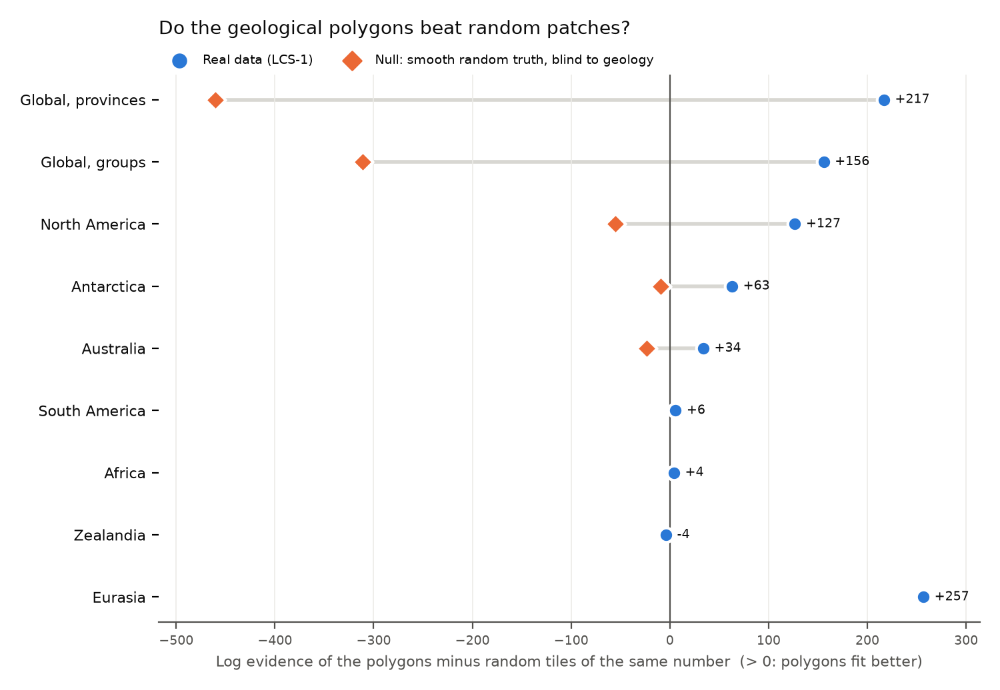
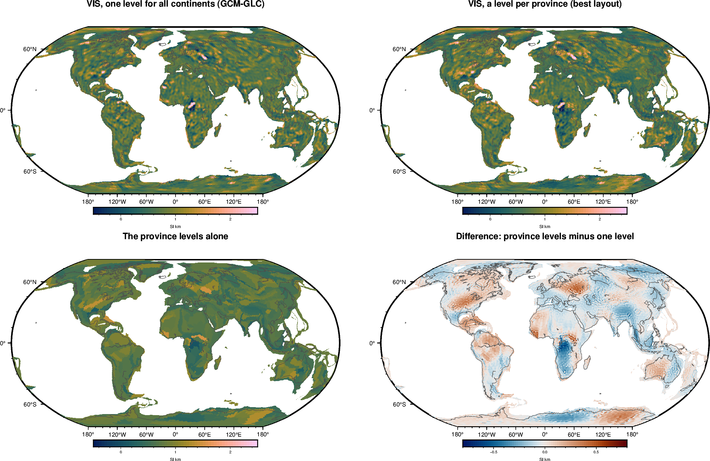
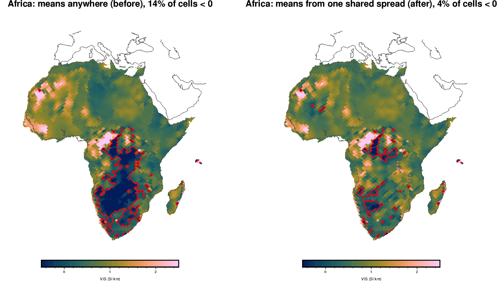
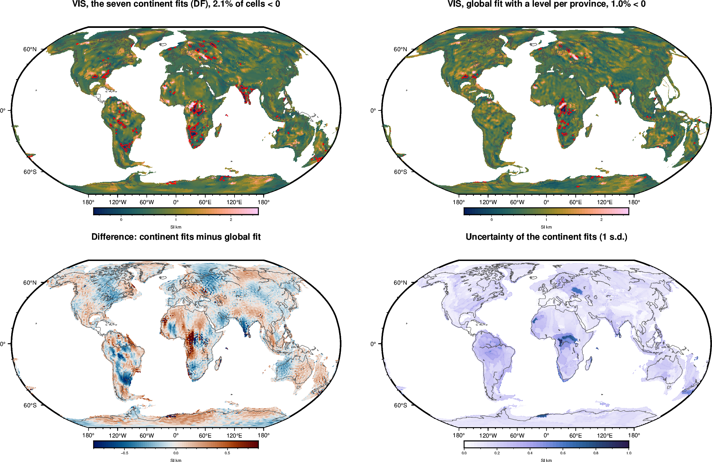
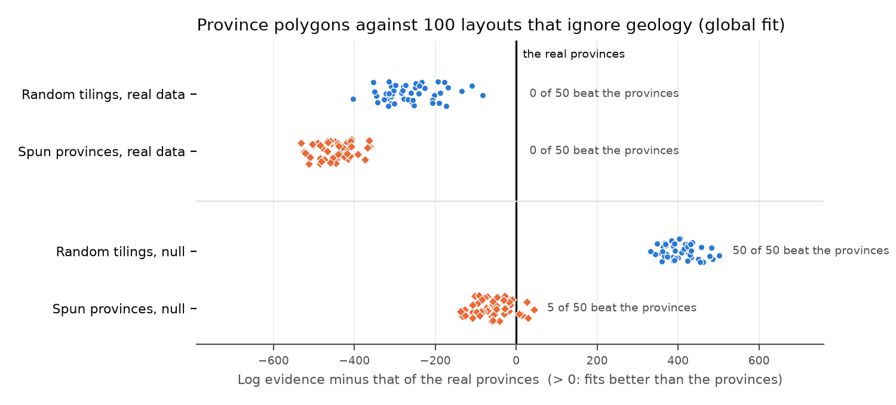
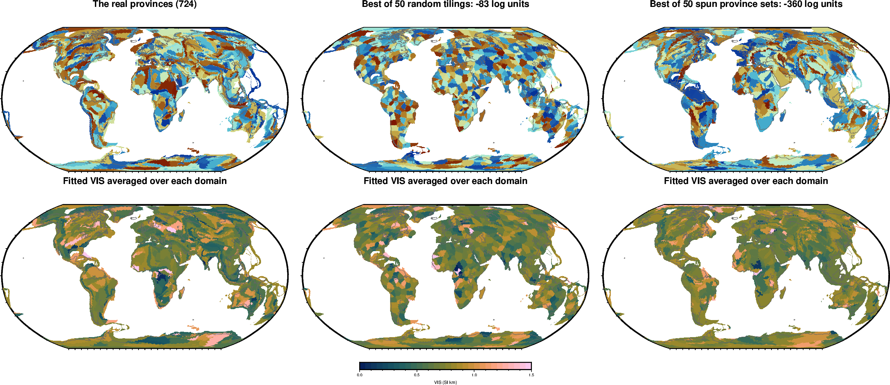
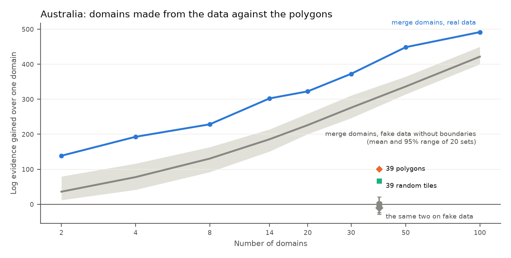
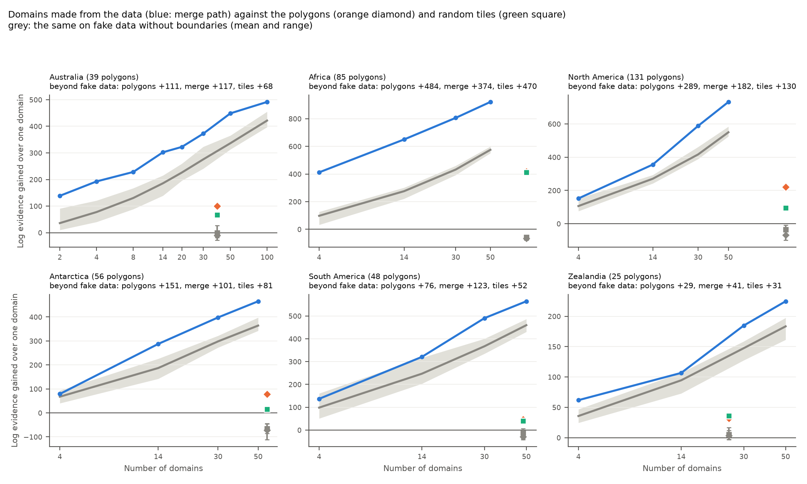

# Overnight runs, 10–11 October 2026: do the geological polygons describe crustal magnetisation?

*Plan and decisions: [experiment-global-layouts.md](../../experiment-global-layouts.md), ADRs 0007 (amendment), 0008–0010. Figures: `make_maps.py` and `make_chart.py` in this folder, run from the repository root.*

## The question

We asked whether VIS changes at the boundaries of the Hasterok et al. (2022) provinces, both in the global fit to the Gauss coefficients and in the continent fits. For each fit, the polygons were compared with **random tiles of the same number**: patches placed with no regard to geology. Grouping cells into any patches helps when VIS is smooth over a few hundred km, so the polygons only count if they beat the random tiles.

Each comparison was also run on a **null**: a smooth random truth that ignores geology. On the null the polygons should not win. Crust1.0 turned out not to be a null, because crustal thickness itself follows the provinces.

## 1. Globally, VIS follows the polygons

On real data the province polygons beat random tiles of the same number by **217** log units, and the province groups beat theirs by **156**. On the null they lose by 460 and 311. The global fits use the ocean-model error (ADR 0009); the earlier fits with a fitted noise scale gave the same ranking (+274 and +184).

The synthetic checks behave as they should:

| Truth | Result |
|---|---|
| One level everywhere | No layout gains more than 2 log units |
| Group levels | Groups win, and every random-tile control is at least 2480 behind |
| Smooth random field | The polygons lose to the random tiles (see above) |

The best global map gives each province its own level:

Compared with one level for all continents (bottom right):
- **Lower:** the Congo–Kalahari region of Africa, India, Southeast Asia and Dronning Maud Land.
- **Higher:** central North America, western Siberia, West Africa, Australia and Wilkes Land.

The province levels spread by 0.25 SI·km about a global level of 0.71 SI·km.

## 2. On the continents, the answer differs

The same test in the continent fits (DF, with GCM-GLC as the background outside each continent):

| Continent | Polygons vs random tiles | Null (random truth) |
|---|---|---|
| Eurasia | **+257** | −42 |
| North America | **+127** | −55 |
| Antarctica | **+63** | −9 |
| Australia | **+34** | −23 |
| South America | +6 | +5 |
| Africa | +4 | −34 |
| Zealandia | −4 | −10 |

The polygons carry information in Eurasia, North America, Antarctica and Australia: they beat random tiles on real data and not on the null. In South America and Zealandia the real-data result is no better than the null. In Africa the polygons do 38 better than on the null, a weak signal at most. (Nulls for South America, Africa, Zealandia and Eurasia added 12 October.)

## 3. Sharing one spread for the domain means removes most negative VIS

Each domain's mean is now drawn from one shared distribution with a fitted spread, instead of being free between 0 and 4 SI·km (ADR 0007, amendment). The share of cells below zero falls:
- Africa from 14% to **4%**;
- South America from 11% to **4%**;
- Zealandia from 3.2% to 2.5%.
- Eurasia from 2.1% to 1.6%. Its domain means that lay outside 0–4 SI·km (South India and Sri Lanka, small Aegean and Anatolian units) are now all inside.

Other continents are unchanged (0.3–1%).

In Africa, North America, Antarctica and Eurasia the fitted spread of the domain means drops to its lower bound (0.01 SI·km): **in these continents the domains hardly differ in their mean level.** Where the polygons help, they do so through the patterns inside each domain, which start afresh at the boundaries. This points to idea 2 (DF-GLC: separate patterns per domain in the global fit) as the next step, rather than more work on domain levels.

## 4. The ocean model's error is real, and confined to the oceans

The ocean-model error of ADR 0009 was confined to the oceans, and the evidence chose an amplitude of **16 nT** RMS Br. Adding it raises the global evidence by about 3300 log units over measured noise alone, but leaves the ranking of the layouts unchanged.

## 5. A better background outside each continent changes little

The local fits were run again, with the best global layout fit as the background outside each continent in place of GCM-GLC. Every continent changed only slightly:
- the mean levels fell by 0.01–0.03 SI·km (e.g. Australia 0.65 to 0.62);
- the evidence rose a little and the ring misfit fell a little (below).

The exception is Eurasia: its evidence rises by 60, the ring misfit falls from 27 to 26 nT, and its mean level drops from 0.60 to 0.55 SI·km.

The rise of the continent means toward GCM's level, noted in the handover, is therefore mostly not the background's doing.

The changes are small but all go the same way: the log evidence rises on every continent (Africa +30, South America +22, North America +9, Australia +5, Antarctica +10, Eurasia +60, Zealandia +10). This is now the default background (ADR 0011).

The seven continent fits with this background, on one world map against the global fit itself (cells shared by two continents averaged; 92.5% of the global cells are covered, Central America, Greenland and some islands are not):

## 6. DF-GLC: separate patterns per domain in the global fit (added 11 October, afternoon)

DF-GLC is DF's model fitted to the global coefficients: a fractal pattern inside each domain, independent between domains, so the pattern breaks at every domain boundary, with the ocean-model error at 16 nT. It is compared against one pattern with no breaks anywhere. Each layout's pattern shape (β, patch size) was searched separately.

| Layout | Real LCS-1 | S3: truth breaks at group edges | S5: truth with no breaks |
|---|---|---|---|
| One pattern, no breaks | **0** (β 2.5, 350 km) | −1170 | **0** |
| Groups | −55 (β 2.0, 700 km) | **0** | −628 |
| Provinces | −94 (β 2.0, 700 km) | — | — |
| Random tiles as many as the groups | −423 | −1623 | −546 |
| Random tiles as many as the provinces | −626 | — | — |

(Log evidence relative to the best layout in each column.)

- **The method works.** It finds breaks where the truth has them (S3: groups by 1170) and rejects them where it has none (S5). In S3 it also recovers the truth's strength (0.40 SI·km) and the spread of the levels (0.22 against 0.20).
- **Real VIS shows no hard breaks at province boundaries.** One pattern running across all boundaries fits best, by 55 over groups and 94 over provinces.
- **But geological boundaries are far closer to real VIS edges than random ones.** If breaks are imposed, those at group boundaries cost 368 less than breaks at random places, and those at provinces 532 less. On S5 (no edges in the truth) the groups did 83 worse than random tiles, not better.
- **Together:** VIS changes more across geological boundaries than elsewhere, but it does not start afresh at each one. That is the soft-boundary model deferred in ADR 0010: one pattern shared across boundaries, plus independent domain patterns, with the split between the two fitted by the evidence.

The DF-GLC map (one pattern) has v0 0.71 SI·km, 2.1% of cells below zero and an RMS misfit of 25.0 nT: `inversions/results/global/df_glc_lcs1_16-133_one_best_maps.png`.

## 7. Could any polygons do as well? 100 layouts that ignore geology (added 11 October, evening)

Using the polygons assumes they carry real information about magnetisation. This tests that assumption. The 724 provinces (global fit, as in section 1, ocean-model error 16 nT) were ranked against:
- **50 random tilings:** 724 Voronoi tiles each, seeds drawn at random over the continents.
- **50 spun province sets:** each continent's real polygons rotated about its centre by a random 60–300°, then trimmed to the continent. They keep the polygons' shapes and their mix of sizes; only their position relative to the geology changes.

The same 100 layouts were also fitted to the null (S5: a smooth random truth that ignores geology).

| | Best | Median | Worst | Beat the provinces |
|---|---|---|---|---|
| Random tilings, real data | −83 | −277 | −404 | 0 of 50 |
| Spun provinces, real data | −360 | −454 | −531 | 0 of 50 |
| Random tilings, null | +502 | +407 | +332 | 50 of 50 |
| Spun provinces, null | +44 | −58 | −138 | 5 of 50 |

(Log evidence relative to the real provinces.)

- **On real data, none of the 100 beats the provinces.** The best random tiling falls 83 log units short, and the best spun set 360 short.
- **On the null, the provinces have no advantage.** They sit among the spun sets (5 of 50 beat them), and every random tiling beats them. Random tiles are more even in size, which suits a truth that is equally smooth everywhere.
- **Position is what matters, not shape or size.** The spun sets have the same shapes and sizes as the provinces. They match the provinces on the null but lose by 360–530 on real data.

Top: the layouts (colours only tell the domains apart). Bottom: the fitted VIS averaged over each domain. With the real provinces the averages follow known structures: the Congo low, the high cratons of West Africa and North America, and Wilkes Land. The best random and spun layouts break these up or smear them across several domains.

## 8. Domains made from the data (FD-merge) (added 12–13 October)

FD-merge draws domains from the data alone: it starts with every cell as its own domain and repeatedly joins the two neighbours whose levels differ least. Here its partitions from 2 to 100 domains were each scored with DF (a fractal pattern inside each domain, domain levels from one shared spread), alongside the 39 polygons and 39 random tiles (`df_aus_lcs1_16-133_gcmbg_gm_mpath.toml`).

On real data the merge domains' score keeps rising up to 100 domains, so it can't pick a number. The reason is that the domains are drawn from the same data that score them. To measure that effect, the same steps were run on 20 fake data sets with no boundaries at all (drawn from DF's one-domain fit to Australia: `acceptance/df_merge_path_null.py`).

| Layout | Gain over one domain, real data | Same, fake data (mean ± s.d.) | Real minus fake |
|---|---|---|---|
| 39 polygons | +101 | −10 ± 9 | **+111** |
| Merge, 14 domains | +302 | +186 ± 19 | **+117** |
| Merge, 50 domains | +449 | +336 ± 15 | +112 |
| Merge, 2–100 domains | | | +70 to +117 |
| 39 random tiles | +67 | −1 ± 11 | +68 |

- **Most of the merge domains' apparent gain is an artefact** of choosing them from the data: on fake data they gain 36–421 without any real boundary.
- **Beyond that artefact, the merge domains do no better than the polygons.** The real excess is about the same, 100–117, at every number of domains, and the polygons reach 111 without being drawn from the data.
- **So the evidence can't choose the number of merge domains,** and the earlier result that FD-merge's 14 domains beat the polygons by 212 was mostly this artefact.
- **What works:** the polygons, which carry the information from outside the data. FD-merge is still useful for showing where the data alone would draw lines, but its scores must be set against fake data before they are compared.

**All continents (added 13 October).** The same test on the other continents except Eurasia (merge partitions at 4, 14, 30 and 50 domains; 10 fake data sets for Zealandia, South America and Antarctica, 5 for Africa and North America; `df_<continent>_lcs1_16-133_gcmbg_gm_mpath`). The fake data are drawn from each continent's own one-domain DF fit.

| Continent | Polygons | Best merge partition | Random tiles |
|---|---|---|---|
| Africa | **+484** | +374 | +470 |
| North America | **+289** | +182 | +130 |
| Antarctica | **+151** | +101 | +81 |
| Australia | +111 | +117 | +68 |
| South America | +76 | **+123** | +52 |
| Zealandia | +29 | +41 | +31 |

(Log evidence gained over one domain, minus the same gain on the fake data: what each layout captures beyond chance.)

- **The polygons match or beat the domains made from the data almost everywhere.** They are clearly better in Africa, North America and Antarctica, level in Australia, and behind only in South America (by 47) and Zealandia (by 12, within the spread of the fake data).
- **In Africa any division helps:** random tiles gain nearly as much as the polygons. Africa's VIS is far from one uniform pattern, but the polygons add little beyond that there (as in section 2).
- **So domains drawn from the data are no substitute for the polygons.** Once the advantage of fitting the same data is removed, they carry no more information, and the evidence can't choose their number.

The sampling FD methods (FD-vor, FD-lvor, FD-part), which draw many random partitions, did not settle on an answer in Australia, so they were left out here.

## 9. The thickness of the magnetic layer hardly matters (added 13 October)

All fits put the magnetic layer from the top of basement to a constant 30 km. The global layout fit was rerun with its base at the LithoRef18 Moho (Afonso et al. 2019) instead (`gcm_glc_layouts_oc_moho_lcs1_16-133`). Cell VIS correlates at 0.999 between the two (typical difference 0.03 SI·km against a spread of 0.35), the province levels at 0.998, and the mean drops from 0.725 to 0.706 SI·km. The data slightly prefer the constant 30 km (by 17 log units). VIS is what the data fix; a susceptibility needs a thickness model on top (VIS divided by the magnetic thickness) and changes none of the results here.

## Caveats

- Each synthetic check uses one noise draw, and the 100-layout test one noise draw of the null.
- Random tiles are more even in size than the polygons. That cuts against the polygons on the null, so a null closer in size could narrow the margins. The spun province sets (section 7) remove this difference and give the same answer.

## Decisions for you

1. ~~Start DF-GLC (idea 2)?~~ Done, see section 6. Next candidate: **the soft-boundary model** (ADR 0010, deferred). It adds one hyperparameter (the split), so it costs about the same as a DF-GLC layout.
2. ~~Run the local null for Eurasia, South America, Africa and Zealandia?~~ Done (section 2).
3. ~~Which background should local fits use from now on?~~ The global layout fit (ADR 0011): every continent's evidence rises with it (+5 to +60). GCM-GLC stays as a check for the polygon tests.
