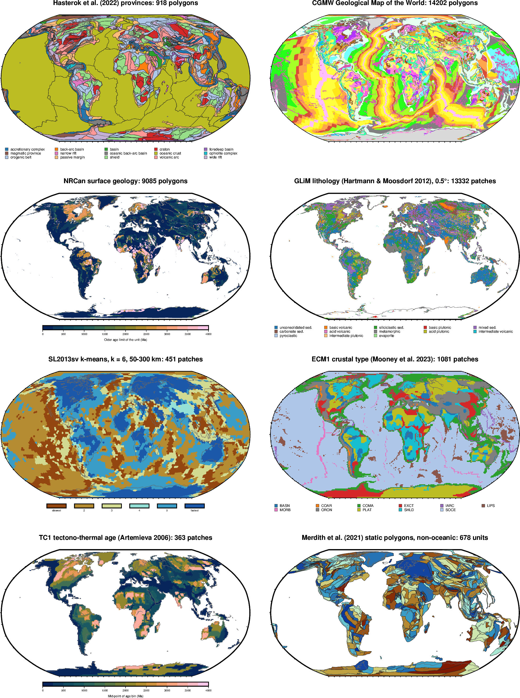
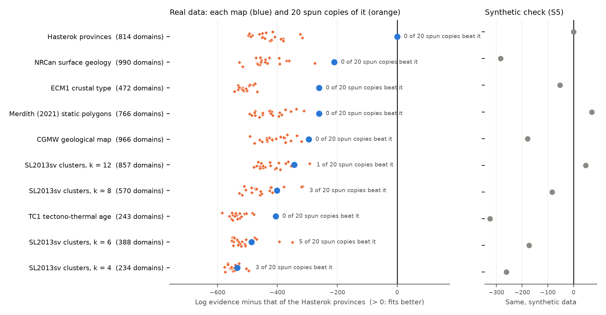
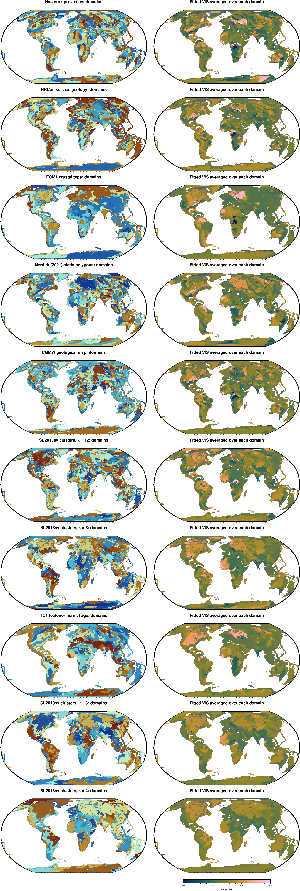

# Candidate partitions to test against the magnetic field

The Hasterok provinces beat random and shifted versions of themselves. These are other maps that claim to divide the lithosphere into meaningful units. Each can go through the same test, and the scores can be compared, globally and per continent. In the test every connected patch gets its own magnetization, so what is scored is where each map puts its boundaries. The colours below are for reading the maps only.

## The eight candidates

- **Hasterok et al. (2022) provinces**: the gprm `GlobalTectonics` download.
- **CGMW Geological Map of the World**: `~/Data/Geology/CGMW_GeologicalUnits.shp`, drawn in the map's own colours. It covers the ocean floor too.
- **NRCan surface geology**: `gprm` `fetch_SurfaceGeology`, coloured by the older age limit of each unit.
- **GLiM lithology** (Hartmann & Moosdorf 2012): the 0.5° grid from PANGAEA (doi:10.1594/PANGAEA.788537), saved in `~/Data/Geology/GLiM/`. Water bodies, no-data cells and ice are left blank because they are not rock types.
- **SL2013sv clusters**: k-means (k = 6) on absolute S-wave velocity profiles from 50 to 300 km at the 7842 model knots. Each 0.5° node takes the nearest knot along a great circle. The number of clusters and the depth range are free choices for now.
- **ECM1 crustal type** (Mooney et al. 2023): the 1° `Type` column of `ECM1.txt`.
- **TC1 tectono-thermal age** (Artemieva 2006): the 1° age-bin grid digitised by C. Heine.
- **Merdith et al. (2021, v1.1) static polygons**: from the gprm cache, leaving out the oceanic ones (feature type `gpml:Basin`).

For the gridded maps, the patch counts treat cells of the same class that touch (4 neighbours, across the dateline) as one patch.

Not shown:
- CRUST1.0 crustal types: the type file is only available on request.
- Pearson et al. (2021) cratons: not on this machine.
- Hasterok plates: plate outlines do not follow crustal type.

Made by `make_candidates.py`.

## Batch 1: the least detailed maps, global fit

This compares the Hasterok provinces with SL2013sv clusters (k = 4, 6, 8, 12), TC1, ECM1 and the Merdith static polygons. Each map was fitted to the LCS-1 field (degrees 16–133) on all continents, in the same way as the earlier ensemble runs, with the ocean-model error at 16 nT.

How each map becomes domains (`remit/inversion/candidates.py`):
- Each ~100 km cell takes the map unit covering most of it.
- Every connected patch of a unit becomes its own domain. Patches smaller than 3 cells are merged into their neighbour.
- Cells that no unit covers form one "rest" domain per continent.
- SL2013sv was clustered only from the model knots that lie on continents.

The spin test turns each continent's units by a random angle about the continent's centre (20 draws), then applies the same patch rule.

### Ranking and spin test

| Map | Domains | Evidence vs Hasterok | Real minus median spun copy | Spun copies that beat it |
|---|---|---|---|---|
| Hasterok provinces | 814 | 0 | +431 | 0 of 20 |
| ECM1 crustal type | 472 | −261 | +253 | 0 of 20 |
| Merdith static polygons | 766 | −261 | +162 | 0 of 20 |
| TC1 tectono-thermal age | 243 | −406 | +132 | 0 of 20 |
| SL2013sv, k = 12 | 857 | −344 | +89 | 1 of 20 |
| SL2013sv, k = 8 | 570 | −401 | +62 | 3 of 20 |
| SL2013sv, k = 6 | 388 | −487 | +36 | 5 of 20 |
| SL2013sv, k = 4 | 234 | −534 | +10 | 3 of 20 |

- **Four maps carry real information about the magnetic field:** Hasterok, ECM1, Merdith and TC1. Each beats all 20 copies of itself spun to the wrong place. Hasterok carries by far the most.
- **SL2013sv does not pass.** At every k, some spun copies fit as well as or better than the real clustering. So the 50–300 km velocity structure shows no clear link to where the magnetic sources change. Its score rises with k because it has more, smaller domains.
- **The synthetic check** (right of the chart; data with no geology in it) shows what domain count alone does. Maps with about 800 domains score best, and Merdith comes out ahead of Hasterok. So Hasterok's lead on real data is not an artefact of its domain count. TC1's low raw rank, however, is mostly due to its few domains. For TC1, the spin test is the fairer measure.

### Batch 2: detailed surface geology (NRCan, CGMW)

The same test, for two detailed surface-geology maps. Here a unit is a legend entry: rock type plus age range for NRCan (439 entries), and `CODE_G` for CGMW (51 entries). Touching polygons of the same entry form one patch. Polygons keep their holes, and where polygons overlap the smallest one wins. CGMW lakes and glaciers are left out. The chart above includes both maps.

| Map | Domains | Evidence vs Hasterok | Real minus median spun copy | Spun copies that beat it |
|---|---|---|---|---|
| NRCan surface geology | 990 | −210 | +237 | 0 of 20 |
| CGMW geological map | 966 | −296 | +115 | 0 of 20 |

- **Both maps pass the spin test.** NRCan has the second-best evidence of all ten maps, behind only Hasterok.
- **The synthetic check rules out domain count as the explanation.** On data with no geology, both maps score below Hasterok (NRCan −284, CGMW −179), even though they have more domains. Their real-data gap to Hasterok is therefore not caused by their domain count.

So six maps carry information about the magnetic field: Hasterok, NRCan, ECM1, Merdith, CGMW and TC1. The Hasterok provinces carry the most.

### Domains and fitted VIS

Left: each map's domains in random colours. Right: the fitted VIS averaged over each domain. The maps are ordered by evidence, best first.

Made by `make_ranking.py` from the runs `inversions/gcm_glc_cand1_*` and `gcm_glc_cand2_*` (queues: `acceptance/cand1_queue.sh`, `cand2_queue.sh`).
