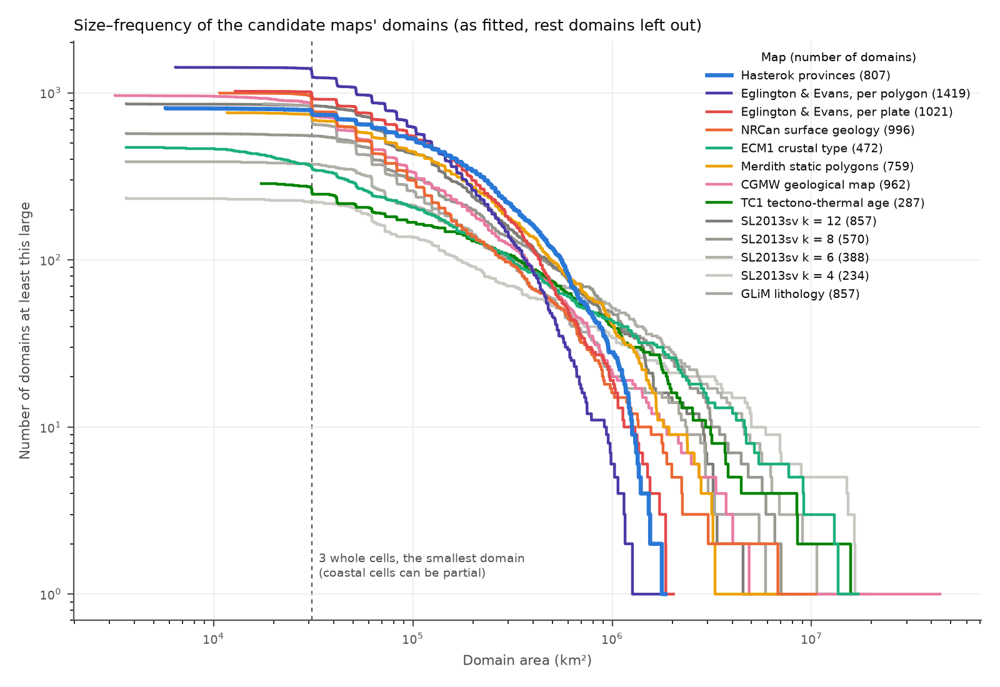

# Candidate partitions to test against the magnetic field

The Hasterok provinces beat random and shifted versions of themselves. These are other maps that claim to divide the lithosphere into meaningful units. Each can go through the same test, and the scores can be compared, globally and per continent. In the test every connected patch gets its own magnetization, so what is scored is where each map puts its boundaries. The colours below are for reading the maps only.

## The candidates

- **Hasterok et al. (2022) provinces**: the gprm `GlobalTectonics` download.
- **CGMW Geological Map of the World**: `~/Data/Geology/CGMW_GeologicalUnits.shp`, drawn in the map's own colours. It covers the ocean floor too.
- **NRCan surface geology**: `gprm` `fetch_SurfaceGeology`, coloured by the older age limit of each unit.
- **GLiM lithology** (Hartmann & Moosdorf 2012): the 0.5° grid from PANGAEA (doi:10.1594/PANGAEA.788537), saved in `~/Data/Geology/GLiM/`. Water bodies, no-data cells and ice are left blank because they are not rock types.
- **SL2013sv clusters**: k-means (k = 6) on absolute S-wave velocity profiles from 50 to 300 km at the 7842 model knots. Each 0.5° node takes the nearest knot along a great circle. The number of clusters and the depth range are free choices for now.
- **ECM1 crustal type** (Mooney et al. 2023): the 1° `Type` column of `ECM1.txt`.
- **TC1 tectono-thermal age** (Artemieva 2006). TC1 is read from the age map in C. B. Keller's [StatisticalGeochemistry](https://github.com/brenhinkeller/StatisticalGeochemistry) (MIT licence), a 1/3° grid, through gprm's `Geology.fetch_TC1`. The overview figure above shows an earlier 1° grid digitised by C. Heine, which agrees with it on 82% of the continental area. All TC1 results below were rerun with the Keller grid (runs `gcm_glc_cand_tc1k_*`, plus the spin test).
- **Merdith et al. (2021, v1.1) static polygons**: from the gprm cache, leaving out the oceanic ones (feature type `gpml:Basin`).
- **Eglington & Evans (2025) plate polygons**: `~/Downloads/EglingtonEvans2025_supporting/PlatePolygons_All.shp`, continental polygons only. Added after the overview figure was made, so it is not shown in it.

For the gridded maps, the patch counts treat cells of the same class that touch (4 neighbours, across the dateline) as one patch.

Not shown:
- CRUST1.0 crustal types: the type file is only available on request.
- Pearson et al. (2021) cratons: not on this machine.
- Hasterok plates: plate outlines do not follow crustal type.

Made by `make_candidates.py`.

## Batch 1: the least detailed maps, global fit

This compares the Hasterok provinces with SL2013sv clusters (k = 4, 6, 8, 12), TC1, ECM1 and the Merdith static polygons. Each map was fitted to the LCS-1 field (degrees 16–133) on all continents, in the same way as the earlier ensemble runs, with the ocean-model error at 16 nT.

How each map becomes domains (`remit/inversion/candidates.py`):
- Each ~100 km cell takes the map unit covering most of it.
- Every connected patch of a unit becomes its own domain. Patches smaller than 3 cells are merged into their neighbour.
- Cells that no unit covers form one "rest" domain per continent.
- SL2013sv was clustered only from the model knots that lie on continents.

The spin test turns each continent's units by a random angle about the continent's centre (20 draws), then applies the same patch rule.

### Ranking and spin test

| Map | Domains | Evidence vs Hasterok | Real minus median spun copy | Spun copies that beat it |
|---|---|---|---|---|
| Hasterok provinces | 814 | 0 | +431 | 0 of 20 |
| ECM1 crustal type | 472 | −261 | +253 | 0 of 20 |
| Merdith static polygons | 766 | −261 | +162 | 0 of 20 |
| TC1 tectono-thermal age | 294 | −370 | +168 | 0 of 20 |
| SL2013sv, k = 12 | 857 | −344 | +89 | 1 of 20 |
| SL2013sv, k = 8 | 570 | −401 | +62 | 3 of 20 |
| SL2013sv, k = 6 | 388 | −487 | +36 | 5 of 20 |
| SL2013sv, k = 4 | 234 | −534 | +10 | 3 of 20 |

- **Four maps carry real information about the magnetic field:** Hasterok, ECM1, Merdith and TC1. Each beats all 20 copies of itself spun to the wrong place. Hasterok carries by far the most.
- **SL2013sv does not pass.** At every k, some spun copies fit as well as or better than the real clustering. So the 50–300 km velocity structure shows no clear link to where the magnetic sources change. Its score rises with k because it has more, smaller domains.
- **The synthetic check** (right of the chart; data with no geology in it) shows what domain count alone does. Maps with about 800 domains score best, and Merdith comes out ahead of Hasterok. So Hasterok's lead on real data is not an artefact of its domain count. TC1's low raw rank, however, is mostly due to its few domains. For TC1, the spin test is the fairer measure. (The synthetic check here used one draw; the next section repeats it with 11.)

### Batch 2: detailed surface geology (NRCan, CGMW)

The same test, for two detailed surface-geology maps. Here a unit is a legend entry: rock type plus age range for NRCan (439 entries), and `CODE_G` for CGMW (51 entries). Touching polygons of the same entry form one patch. Polygons keep their holes, and where polygons overlap the smallest one wins. CGMW lakes and glaciers are left out. NRCan's ice was at first counted as a unit; the rows below are from the rerun with ice left out (batch 3), like CGMW's glaciers. The chart above includes both maps.

| Map | Domains | Evidence vs Hasterok | Real minus median spun copy | Spun copies that beat it |
|---|---|---|---|---|
| NRCan surface geology | 1003 | −200 | +250 | 0 of 20 |
| CGMW geological map | 966 | −296 | +115 | 0 of 20 |

- **Both maps pass the spin test.**
- **The synthetic check rules out domain count as the explanation.** On data with no geology, both maps score well below Hasterok (in the 11 draws below: NRCan −327, CGMW −308 on average), even though they have more domains. Their real-data gap to Hasterok is therefore not caused by their domain count.

### Batch 3: GLiM and the Eglington & Evans (2025) plate polygons

- **GLiM lithology:** the 0.5° grid (PANGAEA 788537), 13 rock classes. Water, no-data and ice cells go to the rest domains.
- **Eglington & Evans (2025):** the continental polygons (`COTID` C) of `PlatePolygons_All.shp`, the building blocks of their plate model. The overlapping "top", "bottom" and "older" layers are not used. It is run two ways: one unit per plate ID (a reconstruction block, 1,342 of them) and one unit per polygon (2,306).

| Map | Domains | Evidence vs Hasterok | Real minus median spun copy | Spun copies that beat it |
|---|---|---|---|---|
| Eglington & Evans, per polygon | 1426 | **+129** | +540 | 0 of 20 |
| Eglington & Evans, per plate | 1028 | +12 | +481 | 0 of 20 |
| GLiM lithology | 864 | −469 | +74 | 1 of 20 |

- **The Eglington & Evans polygons fit better than the Hasterok provinces.** Split per polygon, they are 129 log units ahead of Hasterok, and they beat their own spun copies by the largest margin of any map: +540 over the median copy and +434 over the best one. Per plate, they are level with Hasterok (+12).
- **The lead is not explained by domain geometry.** On the synthetic data the Eglington & Evans maps score about the same as Hasterok (per polygon −9, per plate −30 on average). Like Hasterok, they have no domains larger than about 2×10⁶ km² (see the size plot).
- **GLiM does not pass the spin test.** One of its 20 spun copies beats it, and the real map is only 74 above the median copy. Surface lithology on a 0.5° grid, without ages, carries little information that the magnetic field can see.

So eight maps carry information about the magnetic field: Eglington & Evans (both ways), Hasterok, NRCan, ECM1, Merdith, CGMW and TC1. The Eglington & Evans polygons carry the most.

### Correcting for geometry with 11 synthetic draws

A map can score well partly because of its domain geometry: the sizes and shapes of its domains, whatever their position. To estimate that part, every map was also fitted to 11 synthetic data sets. Each is a smooth random magnetization with no geology in it (S5: β 2.5, ℓ 500 km, mean 0.75, sd 0.4 SI·km), with realistic noise and new random seeds for each draw.

**Corrected score = (real evidence − Hasterok's) − (mean S5 evidence − Hasterok's).** It measures how much better a map does on real data than its geometry alone would earn.

| Map | Domains | Real vs Hasterok | S5 mean vs Hasterok (sd of one draw) | Corrected (± about sd/√11) |
|---|---|---|---|---|
| Eglington & Evans, per polygon | 1426 | +129 | −9 (80) | **+139** (±24) |
| NRCan surface geology | 1003 | −200 | −327 (86) | **+127** (±26) |
| Eglington & Evans, per plate | 1028 | +12 | −30 (77) | **+42** (±23) |
| CGMW geological map | 966 | −296 | −308 (92) | **+13** (±28) |
| Hasterok provinces | 814 | 0 | 0 | **0** |
| TC1 tectono-thermal age | 294 | −370 | −360 (78) | **−10** (±23) |
| ECM1 crustal type | 472 | −261 | −215 (118) | **−46** (±36) |
| GLiM lithology | 864 | −469 | −354 (86) | **−115** (±26) |
| SL2013sv, k = 4 | 234 | −534 | −293 (74) | **−241** (±22) |
| Merdith static polygons | 766 | −261 | −1 (72) | **−260** (±22) |
| SL2013sv, k = 8 | 570 | −401 | −120 (62) | **−281** (±19) |
| SL2013sv, k = 6 | 388 | −487 | −187 (81) | **−300** (±24) |
| SL2013sv, k = 12 | 857 | −344 | −6 (73) | **−338** (±22) |

(Also in `corrected.csv`.)

- **Once geometry is allowed for, the maps fall into three groups.** Eglington & Evans per polygon and NRCan come out ahead of Hasterok. Eglington & Evans per plate, CGMW, TC1 and ECM1 are close to it. GLiM, Merdith and every SL2013 clustering are clearly worse.
- **Eglington & Evans per polygon is the only map ahead on both measures.** It leads on raw evidence and after the correction. NRCan's lead appears only after the correction, so it depends on the caveat below.
- **Why the order changes.** On data with no geology, S5 favours Hasterok's geometry: many mid-sized domains and none larger than about 2×10⁶ km² (see the size plot below). It penalises the very large connected units of NRCan, CGMW, TC1 and ECM1, because a field that varies over a few hundred km is fitted badly by one level across 10⁷ km². The correction gives that penalty back.
- **Caveat: the correction is only as good as S5 is realistic.** S5 assumes the magnetization has no uniform structure larger than about 500 km. If real cratons or other large units are uniformly magnetized, a giant domain costs little on real data, and the correction over-credits the maps that have giant domains. The spin test does not depend on this assumption, so it remains the main test. The corrected score is a sensitivity check. A next step would be to repeat the draws with a field that has structure at all scales (a pure power law, no 500 km outer scale).

### Size–frequency of the domains

Each line shows, for one map, how many of its domains (as fitted) are at least a given area. Rest domains are left out. Plates are plotted this way in Bird (2003). A power-law (fractal) size distribution would give a straight line. Flattening at small sizes reflects the 3-cell minimum and the ~100 km cells, and a steep drop at the largest sizes reflects the finite size of the continents.

- **NRCan, CGMW, ECM1 and TC1** have fairly straight middles (about 10⁵–10⁶ km²) and a tail of very large connected units. For example, CGMW's "continental and island arc margins" unit forms one patch of 4×10⁷ km² around the continents.
- **Hasterok and Eglington & Evans** bend all the way down and stop at about 2×10⁶ km². They look more like distributions with a typical size than fractal ones. The two best-fitting maps on raw evidence share this shape.

Made by `make_sizes.py`.

### Domains and fitted VIS

Left: each map's domains in random colours. Right: the fitted VIS averaged over each domain. The maps are ordered by evidence, best first.

Made by `make_ranking.py` from the runs `inversions/gcm_glc_cand1_*`, `gcm_glc_cand2_*`, `gcm_glc_cand_syn_s5_d*` and `gcm_glc_cand_tc1k_*` (queues: `acceptance/cand1_queue.sh`, `cand2_queue.sh`, `cand_s5_queue.sh`, `cand_tc1k_queue.sh`).
