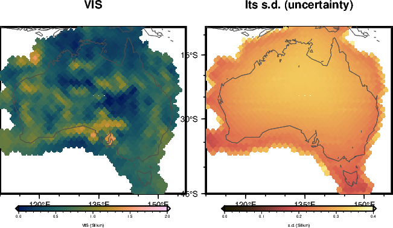
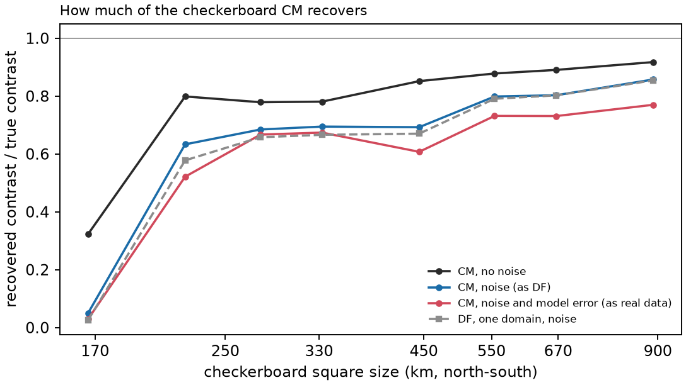

<!-- Rebuild from the repository root:
  export PYTHONPATH=benchmarks/verification:benchmarks:notebooks:$PYTHONPATH OMP_NUM_THREADS=1
  nice -n 15 conda run -n curiesphere python benchmarks/verification/cm_checks.py c1      # ~3 min
  nice -n 15 conda run -n curiesphere python benchmarks/verification/cm_checks.py c2 45   # ~5 min, 3 workers
  nice -n 15 conda run -n curiesphere python benchmarks/verification/cm_checks.py c3      # ~2 min, 3 workers
  conda run -n curiesphere python docs/verification/make_cm_figures.py
  conda run -n riftsclimate quarto render docs/verification/inversion-cm.qmd
-->

# In brief {.unnumbered}

**CM (cell map)** maps VIS as **one level plus a smooth random field**: neighbouring cells are alike over a
correlation length ℓ, and the field varies by s about the level. It has no domains. Three settings (noise scale h,
s and ℓ) are fitted to the data.

{#fig-cm-real}

| Question | Answer |
|---|---|
| Coded correctly? | [Yes: agrees with an independent solver to 10⁻⁷ SI·km]{.good} |
| s.d. right when the errors are as CM assumes? | [Yes: 68% of cells within 1 s.d.]{.good} |
| s.d. right with realistic errors? | [Slightly too small: 65% within 1 s.d.]{.fair} |
| Smallest pattern seen | [about 220 km (2°)]{.fair} |
| Contrast recovered at 900 km | [0.86]{.score} |
| Contrast recovered at 220 km | [0.63]{.score} |
| Contrast recovered at 170 km | [0.05]{.score} |

: CM in one table. Contrasts: fraction of a checkerboard's contrast recovered with the data's noise. {#tbl-cm-brief}

::: {.callout-warning title="Reading a real CM map"}
- **Features smaller than about 220 km are not seen**, and larger ones come back 15–40% too weak.
- **A small s.d. can mean "nothing seen here"**: where a pattern is too small, CM returns a flat map with a small
  s.d.
- **The real fit's large noise scale (h 5.5) is expected** from the way the data are weighted (@sec-weighting).
:::

# How it was tested {#sec-method}

Same problem as the [DF report](inversion-df.html): 1406 cells over Australia, data from degrees 16–133, synthetic
data from the inversion's own cell columns.

- **Correctness**: CM against an independent solver, and on a truth it can represent exactly.
- **Uncertainties**: 45 truths drawn from CM's own model, with two kinds of errors (@sec-weighting).
- **Resolution**: checkerboards of shrinking squares.

## The data weighting {#sec-weighting}

CM-AUS weights the data the way the first Australian build did ("subspace" weighting). After weighting, the errors
are uncorrelated but **their variances range from 0.8 to 57**, and CM treats them as one variance h². So the tests
use two kinds of errors:

- **As CM assumes them** (white, h = 1): checks CM's s.d. under its own assumptions.
- **From the error model** (noise and model error, correlated as on real data): shows what the weighting costs.

# Correctness checks {#sec-correct}

| Check | Agreement |
|---|---|
| Log evidence at fixed settings | [6×10⁻¹¹]{.good} |
| Map, every cell | [3×10⁻⁷ SI·km]{.good} |
| s.d., every cell | [6×10⁻¹² (relative)]{.good} |
| Correlation matrix of the random field | [5×10⁻¹⁵]{.good} |
| Fitted ℓ against a profile of the evidence | [the fit is the best of 41 lengths]{.good} |
| Uniform truth (0.75 SI·km), no noise | [returned to 1×10⁻¹⁶ SI·km]{.good} |

: CM against the independent solver and an exact case. The map differs by 3×10⁻⁷ because CM drops directions with
eigenvalues below 10⁻¹³ of the largest. {#tbl-cm-correct}

{#fig-cm-c1}

## Uncertainties

| Errors | Settings | Error / s.d. (should be 1) | Within 1 s.d. (68%) | Within 2 s.d. (95%) |
|---|---|---|---|---|
| As CM assumes | at the truth | [1.005]{.good} | [68.1%]{.good} | [95.4%]{.good} |
| As CM assumes | fitted | [1.007]{.good} | [68.1%]{.good} | [95.3%]{.good} |
| From the error model | fitted | [1.077]{.fair} | [64.6%]{.fair} | [93.6%]{.good} |

: 45 truths drawn from CM's model (level 0.65, s 0.45 SI·km, ℓ 1400 km, as in the real fit). {#tbl-cm-coverage}

- **Fitting the settings costs nothing.** Three settings are well fixed by the data (unlike DF's 43).
- **With realistic errors h comes out at 4.6–5.1**, close to the real fit's 5.5, and the s.d. is slightly too
  small.

{#fig-cm-spread}

{#fig-cm-maps}

# How small a pattern CM can see {#sec-cm-shrink}

{#fig-cm-shrink-maps}

| Square size | No noise | Noise | Noise and model error | DF (domain fractal), noise |
|---|---|---|---|---|
| 8° (900 km) | [0.92]{.score} | [0.86]{.score} | [0.77]{.score} | [0.85]{.score} |
| 4° (450 km) | [0.85]{.score} | [0.69]{.score} | [0.61]{.score} | [0.67]{.score} |
| 2.5° (280 km) | [0.78]{.score} | [0.68]{.score} | [0.67]{.score} | [0.66]{.score} |
| 2° (220 km) | [0.80]{.score} | [0.63]{.score} | [0.52]{.score} | [0.58]{.score} |
| 1.5° (170 km) | [0.32]{.score} | [0.05]{.score} | [0.03]{.score} | [0.02]{.score} |

: The fraction of the contrast recovered. DF with one domain, for comparison. {#tbl-cm-shrink}

- **CM and DF recover the same**: the data set the limit, not the method.
- **Sharp edges are blurred** even without noise: a smooth field cannot draw square edges.
- **At 1.5° CM's map is flat, yet only 1% of cells are within 1 s.d.** The s.d. does not warn that a pattern was
  missed.

{#fig-cm-shrink-contrast}

# Still to do {#sec-todo}

- CM with the full weighting, as DF uses.
- Data from finer truths, shared with the other methods.

# Rerunning {#sec-rerun}

Code: `benchmarks/verification/cm_checks.py` (tests `c1`, `c2`, `c3`); maps: `docs/verification/make_cm_figures.py`
and `make_overview_figures.py`. Commands at the top of this document's source. Configuration
`inversions/cm_aus_lcs1_16-133.toml`; results in `benchmarks/verification/results/cm_*`.
