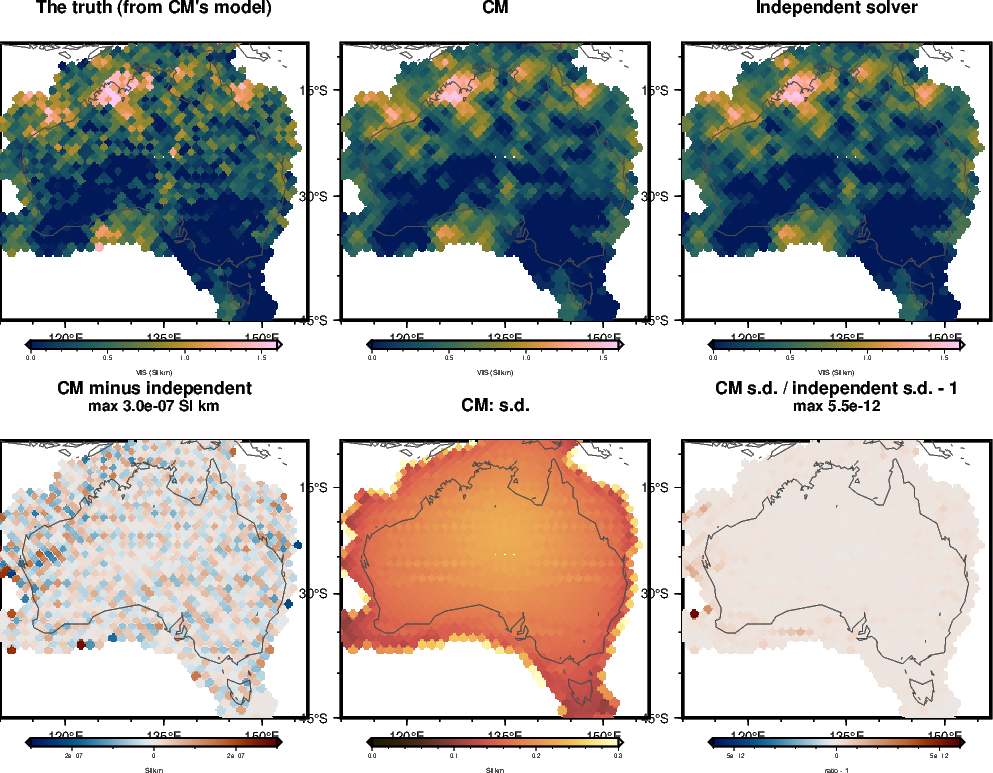

<!-- Rebuild from the repository root:
  export PYTHONPATH=benchmarks/verification:benchmarks:notebooks:$PYTHONPATH OMP_NUM_THREADS=1
  nice -n 15 conda run -n curiesphere python benchmarks/verification/cm_checks.py c1      # ~3 min
  nice -n 15 conda run -n curiesphere python benchmarks/verification/cm_checks.py c2 45   # ~5 min, 3 workers
  nice -n 15 conda run -n curiesphere python benchmarks/verification/cm_checks.py c3      # ~2 min, 3 workers
  conda run -n curiesphere python docs/verification/make_cm_figures.py
  conda run -n riftsclimate quarto render docs/verification/inversion-cm.qmd
-->

# In brief {.unnumbered}

**CM is coded correctly.** It agrees with an independent solver to rounding error, returns a uniform truth exactly,
and its s.d. is exactly right when the data errors are as CM assumes them, whether its settings are known or
fitted.

**Its limitations:**

1. **The smallest pattern CM can see is about 2° (220 km)**, as for DF. With the data's noise, CM recovers 86% of
   the contrast of 900 km squares, 68–69% at 280–450 km and 63% at 220 km; at 170 km nothing. The limit is set
   by the data, not by the method: DF with one domain recovers almost exactly the same.
2. **CM's weighting treats the data errors as white**, though after weighting their variances differ by a factor of
   70. CM absorbs this in one noise scale h. With errors like those of real data, h comes out at about 4.8 (the real
   fit finds 5.5), the s.d. is slightly too small (errors 1.08 times the s.d.), and the recovered contrasts drop
   by another 0.05–0.1.
3. **A small s.d. can mean "nothing seen here"**, as for DF. Where the pattern is too small to see, CM returns a flat
   map with an s.d. that covers the error in only 1% of cells.

# What is checked, and how {#sec-method}

The aims and the test problem are those of the DF part: correctness checks against independent calculations, then
limitation studies with synthetic truths, on the 1406 cells of Australia with data from degrees 16–133. The data
are again computed with the inversion's own cell columns.

## CM in one paragraph

CM maps VIS as **one level plus a smooth random field**: neighbouring cells are correlated over a length ℓ, and the
field has an s.d. s about the level. The level is free. The data errors are taken as white with an s.d. h after
weighting. Three settings (h, s and ℓ) are fitted by the evidence; given them, the map and its s.d. follow exactly
from the data. Unlike DF, CM has no domains.

## The data weighting

CM-AUS weights the data as the first Australian build did (the "subspace" weighting). The data are projected onto
the leading directions of the error model (field-model noise of 20 nT RMS and a model error of 33.4 nT RMS, both
correlated along the surface) and divided by the noise RMS. The weighted errors are then uncorrelated, but their
variances range from 0.8 to 57, with a mean of 33. CM treats them as having one variance, h². DF instead uses the
"full" weighting, after which the errors have unit variance.

Two kinds of synthetic errors are therefore used:

- **Errors as CM assumes them**: white, with h = 1. These check that CM's s.d. is right under its own assumptions.
- **Errors from the error model**: noise and model error drawn with their correlations, as on real data. These show
  what the weighting does.

# Correctness checks {#sec-correct}

## The algebra

CM's map, s.d. and log evidence were recomputed by the independent solver of the DF part, with CM's correlation
matrix built directly from its definition (@fig-cm-c1).

| Check | Result |
|---|---|
| Log evidence at fixed settings (two sets of h, s, ℓ) | Equal to 6×10⁻¹¹ |
| Map, every cell | Equal to 3×10⁻⁷ SI·km (CM leaves out directions with eigenvalues below 10⁻¹³ of the largest) |
| s.d., every cell | Equal to 6×10⁻¹² (relative) |
| Correlation matrix of the random field | Equal to 5×10⁻¹⁵ |
| Fitted ℓ against a profile of the evidence over 41 lengths | The fit is 0.001 above the best of the profile |
| Uniform truth (0.75 SI·km), no noise | Returned to 1×10⁻¹⁶ SI·km |
| Weighted errors | Uncorrelated (correlations 0.022, as 2000 draws give by chance); variances 0.8–57 |

{#fig-cm-c1}

## Uncertainties

Forty-five truths were drawn from CM's own model (level 0.65 SI·km, s 0.45 SI·km, ℓ 1400 km, as in the real CM-AUS
fit) and inverted (@fig-cm-spread, @fig-cm-maps).

| Errors and settings | Error / s.d., spread (should be 1) | Within 1 s.d. (68%) | Within 2 s.d. (95%) |
|---|---|---|---|
| As CM assumes, settings at the truth | 1.005 | 68.1% | 95.4% |
| As CM assumes, settings fitted | 1.007 | 68.1% | 95.3% |
| From the error model, settings fitted | 1.077 | 64.6% | 93.6% |

With errors as CM assumes them, fitting the settings costs nothing. This differs from DF, whose s.d. becomes 1.2
times too small when its settings are fitted. CM has only three settings, and the data fix them well: h comes out
at 0.94–1.04 (middle 68% of truths), s at 0.40–0.51 (true 0.45) and ℓ at 860–2110 km (true 1400).

With errors from the error model, h comes out at 4.6–5.1, close to the 5.5 of the real CM-AUS fit. The real fit's
large h is thus what the error model and the weighting predict, not a sign of misfit beyond the error model. The
s.d. is then slightly too small, and ℓ is less well fixed (490–2980 km).

{#fig-cm-spread}

{#fig-cm-maps}

# Limitations {#sec-limits}

## How small a pattern CM can see {#sec-cm-shrink}

The shrinking checkerboards of the DF part (squares from 8° to 1.5°, 1.5 and 0.5 SI·km) were inverted with CM
without noise, with the same noise draw as DF, and with noise and model error (@fig-cm-shrink-contrast,
@fig-cm-shrink-maps).

| Square size | No noise | Noise (as DF) | Noise and model error | DF, one domain, noise |
|---|---|---|---|---|
| 8° (900 km) | 0.92 | 0.86 | 0.77 | 0.85 |
| 4° (450 km) | 0.85 | 0.69 | 0.61 | 0.67 |
| 2.5° (280 km) | 0.78 | 0.68 | 0.67 | 0.66 |
| 2° (220 km) | 0.80 | 0.63 | 0.52 | 0.58 |
| 1.5° (170 km) | 0.32 | 0.05 | 0.03 | 0.03 |

: The recovered contrast, as a fraction of the true contrast. {#tbl-cm-shrink}

- **The limit is about 2° (220 km)**, as for DF. Without noise CM still recovers a third of the 1.5° contrast; with
  noise, nothing.
- **CM and DF without domains recover almost the same contrast** at every size. The resolution is set by the data,
  their degree range and noise, not by the method.
- **Model error costs another 0.05–0.1** of the contrast at most sizes.
- **Sharp edges are blurred.** Even without noise CM recovers only 78–92% of the contrast at 2° and above: a smooth field
  cannot draw square edges. The fitted correlation length shrinks with the squares, to the lowest value tried
  (40 km) for squares of 2.5° and less.
- **A small s.d. where nothing is seen.** At 1.5° with noise, CM's map is flat and only 1% of cells are within 1
  s.d. of the truth. As for DF, the s.d. does not warn that a pattern was missed.

{#fig-cm-shrink-contrast}

{#fig-cm-shrink-maps}

# What this means for real CM maps {#sec-meaning}

- **The s.d. can be read nearly at face value**: the errors are about 1.1 times the s.d. with errors like those of
  real data.
- **Do not interpret features smaller than about 2° (220 km)**, and expect contrasts at 280–900 km to be
  underestimated by 25–40%, and at 220 km by half, with data like the real data.
- **The large noise scale of the real fit (h 5.5) is expected** from the weighting. It does not by itself point to
  errors outside the error model.

# Still to do {#sec-todo}

- **CM with the full weighting**, as DF uses, to see whether it recovers the contrast lost to model error and
  restores the coverage.
- **Data from finer truths**, shared with DF and the other methods.

# Rerunning {#sec-rerun}

The code is `benchmarks/verification/cm_checks.py` (tests `c1`, `c2`, `c3`), with the maps drawn by
`docs/verification/make_cm_figures.py`; the commands are at the top of this document's source. The tests use the
configuration `inversions/cm_aus_lcs1_16-133.toml` and write their results to `benchmarks/verification/results/cm_*`.
