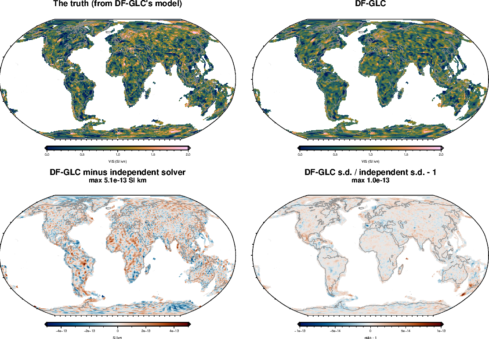

<!-- Rebuild from the repository root (decompositions cached in benchmarks/verification/cache/df_glc, ~2.5 GB each):
  export PYTHONPATH=benchmarks/verification:benchmarks:notebooks:$PYTHONPATH VECLIB_MAXIMUM_THREADS=3
  nice -n 15 conda run -n curiesphere python benchmarks/verification/df_glc_checks.py d1   # ~25 min
  nice -n 15 conda run -n curiesphere python benchmarks/verification/df_glc_checks.py d2   # ~3 h
  nice -n 15 conda run -n curiesphere python benchmarks/verification/df_glc_checks.py d3   # ~2.5 h
  conda run -n curiesphere python docs/verification/make_df_glc_figures.py
  conda run -n riftsclimate quarto render docs/verification/inversion-df-glc.qmd
-->

# In brief {.unnumbered}

**DF-GLC (global domain fractal)** uses the model of DF (domain fractal) in the global fit: **a level per domain,
plus a fractal pattern inside each domain** that starts afresh at its boundary. It is fitted to the Gauss
coefficients of LCS-1, degrees 16–133, on all continental crust. The pattern's strength s, the spread τ of the
domain levels, and the pattern's shape (exponent β and largest patch size ℓ) are fitted.

{#fig-df-glc-real}

| Question | Answer |
|---|---|
| Coded correctly? | [Yes: agrees with an independent solver to 5×10⁻¹³ SI·km]{.good} |
| s.d. right when the truth is as DF-GLC assumes? | [Yes: 68% within 1 s.d., with the shape searched as in real runs]{.good} |
| s.d. right for sharp edges? | [Off: 44–75% within 1 s.d., too narrow for small tiles]{.fair} |
| Contrast recovered at 1630 km | [0.78]{.score} |
| Contrast recovered at 815 km | [0.79]{.score} |
| Contrast recovered at 204 km | [0.30]{.score} |
| Does noise-free data help? | [No: its noise level is held fixed]{.fair} |

: DF-GLC in one table. Contrasts: fraction of a checkerboard's contrast recovered with noise. {#tbl-df-glc-brief}

::: {.callout-warning title="Reading a real DF-GLC map"}
- **Features of about 400 km and larger can be read**; at 200 km two-thirds of the contrast is lost.
- **Broad patterns are kept**, unlike GCM.
- **The s.d. is off where VIS changes sharply inside a domain**, and too narrow for small features.
:::

# How it was tested {#sec-method}

The real global problem: the same 22,591 cells and 17,700 coefficients as GCM, with the data weighted for the noise
and an ocean-model error of 16 nT (ADR 0009). Each pattern shape takes 13–21 minutes to prepare, then seconds per
data set; the tests prepare nine shapes (β 2, 2.5, 3 × ℓ 350, 700, 1400 km) once and reuse them.

# Correctness checks {#sec-correct}

| Check | Agreement |
|---|---|
| Log evidence | [identical]{.good} |
| The level v0 | [3×10⁻¹⁶ SI·km]{.good} |
| Map, every cell | [5×10⁻¹³ SI·km]{.good} |
| s.d., every cell | [1×10⁻¹³ (relative)]{.good} |

: DF-GLC against an independent solver that builds the covariance block by block, at β 2, ℓ 700 km, with the groups
layout of the real runs (437 domains). {#tbl-df-glc-correct}

{#fig-df-glc-d1}

## Uncertainties

| Settings | Error / s.d. (should be 1) | Within 1 s.d. (68%) | Within 2 s.d. (95%) |
|---|---|---|---|
| At the truth | [1.002]{.good} | [68.2%]{.good} | [95.4%]{.good} |
| s and τ fitted, shape at the truth | [1.005]{.good} | [68.0%]{.good} | [95.3%]{.good} |
| s, τ and the shape fitted, as in real runs | [1.005]{.good} | [68.0%]{.good} | [95.3%]{.good} |

: 20 truths drawn from DF-GLC's model with the groups layout (level 0.7, τ 0.1, s 0.4 SI·km, β 2, ℓ 700 km). The
search found the true shape in 19 of 20. {#tbl-df-glc-coverage}

With 17,700 data and three settings, fitting them costs nothing, unlike DF over Australia (43 settings, 849 data).

{#fig-df-glc-spread}

# How large and how small a pattern DF-GLC can see {#sec-limits}

{#fig-df-glc-shrink-maps}

| Tile size | DF-GLC, no noise | DF-GLC, noise | GCM, noise | Within 1 s.d., DF-GLC with noise (68%) |
|---|---|---|---|---|
| 1630 km | [0.75]{.score} | [0.78]{.score} | [0.44]{.score} | [72%]{.good} |
| 815 km | [0.79]{.score} | [0.79]{.score} | [0.77]{.score} | [75%]{.fair} |
| 407 km | [0.66]{.score} | [0.66]{.score} | [0.67]{.score} | [62%]{.fair} |
| 204 km | [0.28]{.score} | [0.30]{.score} | [0.33]{.score} | [44% (too narrow)]{.poor} |

: The fraction of the contrast recovered, DF-GLC as one domain with the shape searched, and GCM on the same truths
and noise. {#tbl-df-glc-shrink}

- **At 200–800 km DF-GLC and GCM recover the same**: the data set the limit.
- **At 1630 km DF-GLC keeps 0.78, GCM 0.44**: the correlated pattern carries broad features.
- **Noise-free data don't help**: the noise level is held at its measured value, as in real runs.
- **Untested: ℓ 175 km**, which the real runs also try; DF-GLC may do slightly better at 204–407 km than shown.

{#fig-df-glc-shrink-contrast}

# Rerunning {#sec-rerun}

Code: `benchmarks/verification/df_glc_checks.py` (tests `d1`, `d2`, `d3`); maps:
`docs/verification/make_df_glc_figures.py` and `make_overview_figures.py`. Commands at the top of this document's
source. Configuration `inversions/df_glc_lcs1_16-133.toml`; one process, 20–40 GB of memory; shape decompositions
cached in `benchmarks/verification/cache/df_glc` (a stopped run resumes); results in
`benchmarks/verification/results/df_glc_*`.
