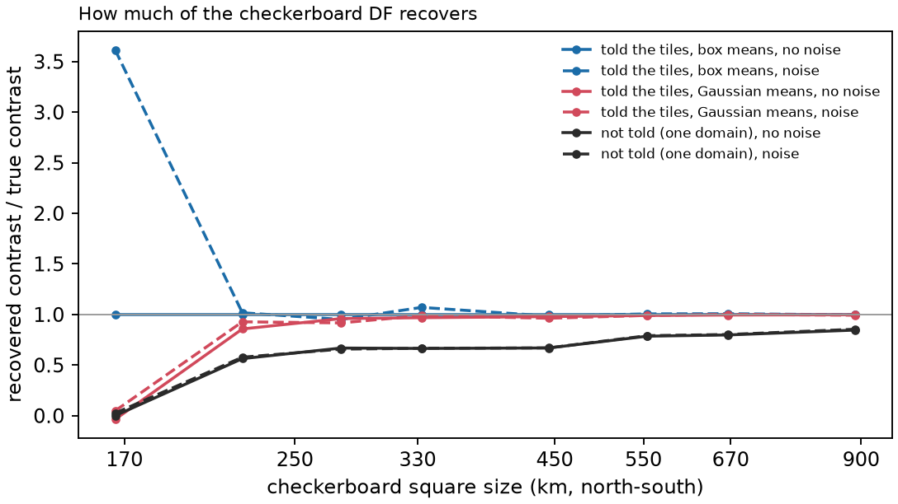

<!-- Rebuild from the repository root:
  export PYTHONPATH=benchmarks/verification:benchmarks:notebooks:$PYTHONPATH OMP_NUM_THREADS=1
  nice -n 15 conda run -n curiesphere python benchmarks/verification/df_checks.py v1        # a few minutes
  nice -n 15 conda run -n curiesphere python benchmarks/verification/df_checks.py v1maps
  nice -n 15 conda run -n curiesphere python benchmarks/verification/df_checks.py v2 45     # ~30 min, 3 workers
  nice -n 15 conda run -n curiesphere python benchmarks/verification/df_checks.py checker   # ~3 min
  nice -n 15 conda run -n curiesphere python benchmarks/verification/df_checks.py shrink    # ~25 min, 3 workers
  nice -n 15 conda run -n curiesphere python benchmarks/verification/df_checks.py mismatch  # ~15 min, 3 workers
  nice -n 15 conda run -n curiesphere python benchmarks/verification/df_checks.py matching  # ~20 min, 3 workers
  nice -n 15 conda run -n curiesphere python benchmarks/verification/df_checks.py sample    # ~3 h, 3 workers; resumes
  conda run -n curiesphere python docs/verification/make_df_figures.py
  conda run -n riftsclimate quarto render docs/verification/inversion-df.qmd
-->

# In brief {.unnumbered}

**DF (domain fractal)** maps VIS as **a level per domain plus a random fractal pattern inside each domain**. The
domains are given in advance (geological polygons, random tiles as a geology-blind control, or one domain), and each
domain's pattern starts afresh at its boundary. Its settings (pattern strength per domain, roughness β, largest patch
size ℓ, and the spread τ of the domain levels) are fitted to the data by the evidence, a score of how well a model
explains the data that penalises extra freedom.

{#fig-df-real}

| Question | Answer |
|---|---|
| Coded correctly? | [Yes: agrees with an independent solver to 10⁻¹⁴]{.good} |
| s.d. right with the settings known? | [Yes: 68% within 1 s.d.]{.good} |
| s.d. right with the settings fitted? | [1.2× too small: 63% within 1 s.d.]{.fair} |
| s.d. right with the settings sampled (real Australian run)? | [1.1× too small: 65% within 1 s.d.]{.fair} |
| Smallest pattern seen | [about 220 km (2°)]{.fair} |
| Contrast recovered at 900 km | [0.85]{.score} |
| Contrast recovered at 220 km | [0.58]{.score} |
| Contrast recovered at 170 km | [0.02]{.score} |
| Does the evidence pick the right domains? | [Yes, in every test]{.good} |

: DF in one table. Contrasts: fraction of a checkerboard's contrast recovered with noise, DF as one domain. {#tbl-df-brief}

::: {.callout-warning title="Reading a real DF map"}
- **The s.d. is about 1.1–1.2× too small.**
- **A small s.d. can mean "nothing seen here"**, not "VIS is known here".
- **Features smaller than about 220 km are not seen.**
- **Sharp breaks at polygon edges may come from the layout**; compare the evidence with random tiles and one domain.
- **A polygon win means the field changes character at the polygon edges**, not necessarily that mean VIS differs.
- **The overall level is the least certain part**: the data start at degree 16.
:::

# How it was tested {#sec-method}

- **Correctness checks** compare DF with an independent calculation or an exact case; they should agree to rounding.
- **Limitation studies** show what a correctly coded DF cannot recover; they have no pass mark.

All tests use the Australian problem of the real runs: 1406 cells of about 100 km, data points out to 300 km
offshore compressed to 849 independent data, degrees 16–133, the noise of LCS-1 (20 nT RMS) with its correlations.
Synthetic data come from the inversion's own cell columns (verified in the [forward-model
report](verification.html)), so errors from the cell size or layer depth are not tested here.

# Correctness checks {#sec-correct}

| Check | Agreement |
|---|---|
| Log evidence (Gaussian / box means) | [9×10⁻¹³ / 5×10⁻¹³]{.good} |
| Map, every cell | [2×10⁻¹⁴ SI·km]{.good} |
| s.d., every cell | [2×10⁻¹⁴ (relative)]{.good} |
| Rate of change of the evidence with each setting | [3×10⁻⁸; 1×10⁻⁵ for β (finite differences)]{.good} |
| The fractal pattern's correlation against a direct sum | [moves the map by less than 10⁻⁶ SI·km]{.good} |
| Noise weighting: weighted noise should be white | [variance 1.000, correlations as chance gives]{.good} |
| Checkerboard, one domain per square, box means, no noise | [exact to 10⁻¹⁴ SI·km, down to 624 squares]{.good} |
| 45 truths from DF's model, settings known: within 1 / 2 s.d. | [68% / 95%]{.good} |

: DF against an independent solver ("universal kriging" form, no shared code), exact cases and its own model.
{#tbl-df-correct}

{#fig-v1}

{#fig-checker}

# How far to trust DF's s.d. {#sec-overconfident}

45 truths drawn from DF's own model, inverted with the settings known, fitted, and (for 12 of them) sampled as the
real Australian run does.

| Settings | Error / s.d. (should be 1) | Cells within 1 s.d. (68%) | Within 2 s.d. (95%) | Domain averages within 1 s.d. (68%) |
|---|---|---|---|---|
| Known | [1.00]{.good} | [68%]{.good} | [95%]{.good} | [67%]{.good} |
| Fitted | [1.22]{.fair} | [63%]{.fair} | [91%]{.fair} | [56%]{.poor} |
| Sampled, 2000 steps (explore mode) | [1.14]{.fair} | [64%]{.fair} | [92%]{.fair} | [62%]{.fair} |
| Sampled, 12,000 steps | [1.12]{.fair} | [65%]{.fair} | [93%]{.good} | [62%]{.fair} |

: Coverage of DF's s.d. {#tbl-df-coverage}

{#fig-spread}

{#fig-v2-maps}

| Setting | True | Fitted (middle 68% of truths) | |
|---|---|---|---|
| Roughness β | 2.25 | 2.13–2.55 | [good]{.good} |
| Largest patch size ℓ | 1000 km | 460–5000 km | [too long; at the limit in 22%]{.poor} |
| Spread of domain levels τ | 0.30 SI·km | 0.01–0.35 | [no spread in 40%]{.poor} |
| Pattern strength | 0.30 SI·km | median 0.31 | [good]{.good} |

: How well the settings come back. A long patch size can stand in for different domain levels. {#tbl-df-settings}

- **Fitted settings are treated as exact**, so their own uncertainty is left out of the s.d.
- **Sampling closes only half the gap.** It widens the settings in the right direction, but the map depends only
  weakly on them, so the s.d. rises by just 3–5%. Where the rest comes from is not yet known.

{#fig-sample-spread}

{#fig-sample-maps}

# How small a pattern DF can see {#sec-shrink}

{#fig-shrink-maps}

| Square size | Not told, no noise | Not told, noise | Told, no noise | Told, noise |
|---|---|---|---|---|
| 8° (900 km) | [0.85]{.score} | [0.85]{.score} | [1.00]{.score} | [0.99]{.score} |
| 4° (450 km) | [0.67]{.score} | [0.67]{.score} | [0.98]{.score} | [0.96]{.score} |
| 2.5° (280 km) | [0.67]{.score} | [0.66]{.score} | [0.96]{.score} | [0.92]{.score} |
| 2° (220 km) | [0.56]{.score} | [0.58]{.score} | [0.86]{.score} | [0.93]{.score} |
| 1.5° (170 km) | [0.00]{.score} | [0.02]{.score} | [-0.04]{.score} | [0.05]{.score} |

: The fraction of the contrast recovered. "Told": one domain per square, Gaussian means. {#tbl-df-shrink}

- **Not told, DF rounds off sharp edges**; noise makes almost no difference.
- **At 170 km the checkerboard is lost** in every setting but free levels without noise: most of its field lies above degree 133, and the evidence
  rightly prefers "no variation".
- **When DF sees nothing it reports a small s.d.**: almost no cell is within 1 s.d. of the truth at 170 km.

{#fig-shrink-contrast}

# Choosing the domains {#sec-layouts}

## Wrong domains {#sec-mismatch}

Checkerboards inverted with the real layouts: 39 geological polygons, 39 random tiles and one domain, with the
squares themselves as a reference.

{#fig-mismatch}

- **The evidence ranks the layouts correctly**: true squares first, then one domain, then random tiles and polygons.
- **Wrong domains barely change the contrast**, but **leave steps** where a domain edge cuts a square.
- **With wrong domains the s.d. is too small**: 40–72% of cells within 1 s.d.

## Right domains {#sec-matching}

Truths built with the 39 polygons: a level per polygon (spread 0–0.6 SI·km) plus a fractal pattern that breaks at
polygon edges, or one pattern across the continent (steps only).

{#fig-matching-maps}

| Truth | Polygons win by (log evidence) | RMS error, polygons | RMS error, other layouts |
|---|---|---|---|
| Breaks only (level spread 0) | [75–94]{.good} | [0.12–0.15]{.good} | 0.15–0.32 SI·km |
| Breaks and steps (spread 0.1–0.6) | [85–425]{.good} | [0.12–0.15]{.good} | 0.15–0.32 SI·km |
| Steps only (one pattern, spread 0.3) | [33–169]{.good} | [0.12–0.15]{.good} | 0.15–0.32 SI·km |

: The evidence picks the polygons in all 15 truths, and they give the best map. {#tbl-df-matching}

{#fig-matching-evidence}

- **Breaks in the pattern alone are enough for a clear win.** So a polygon win shows that the field changes
  character at the polygon edges, not on its own that the polygons differ in mean VIS.
- **The fitted spread of the polygon levels can't tell the two apart**: it hit its lower bound in 9 of 15 fits.

## The fit can stop short

From three starting points on the real problem, one fit stopped 0.5 below the best log evidence. Small next to
differences between layouts, but a single fit is not guaranteed to find the best settings.

# Still to do {#sec-todo}

- Where the remaining overconfidence comes from, and whether inflating the s.d. is enough.
- Data from finer truths (0.1° grid, field from remit), so that cell size and layer depth show up.
- Flagging a small s.d. where nothing is seen.
- Whether several starting points should be the default.

# Rerunning {#sec-rerun}

Code: `benchmarks/verification/df_checks.py` (tests `v1`, `v1maps`, `v2`, `checker`, `shrink`, `mismatch`,
`matching`, `sample`); maps: `docs/verification/make_df_figures.py` and `make_overview_figures.py`. Commands at the
top of this document's source. Configuration `inversions/df_aus_syn_rf_gm.toml`; at most 3 workers, low priority;
results in `benchmarks/verification/results/df_*`.
