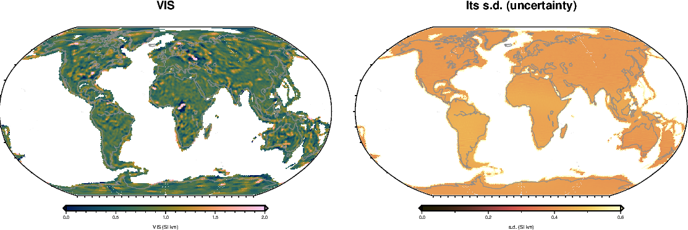
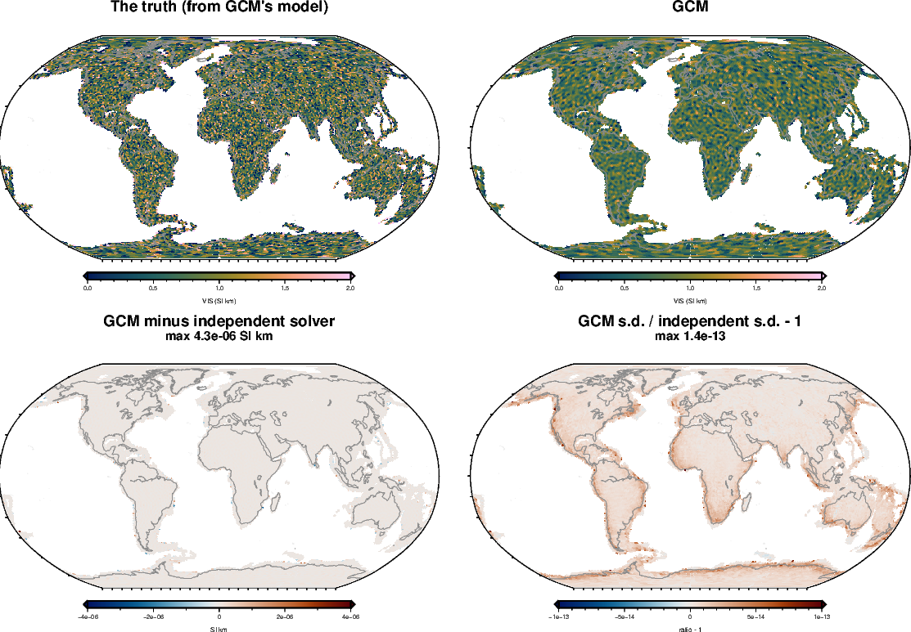

<!-- Rebuild from the repository root:
  export PYTHONPATH=benchmarks/verification:benchmarks:notebooks:$PYTHONPATH VECLIB_MAXIMUM_THREADS=3
  nice -n 15 conda run -n curiesphere python benchmarks/verification/gcm_checks.py g1   # ~3 min (eigendecomposition cached)
  nice -n 15 conda run -n curiesphere python benchmarks/verification/gcm_checks.py g2   # ~10 min
  nice -n 15 conda run -n curiesphere python benchmarks/verification/gcm_checks.py g3   # ~5 min
  nice -n 15 conda run -n curiesphere python benchmarks/verification/compare_checks.py  # ~5 min, after g3
  conda run -n curiesphere python docs/verification/make_gcm_figures.py
  conda run -n riftsclimate quarto render docs/verification/inversion-gcm.qmd
-->

# In brief {.unnumbered}

**GCM (global cell map)** maps VIS on all continental crust (22,591 cells of about 100 km) as **one level plus an
independent departure in each cell**, pulled toward the level. It is fitted to the Gauss coefficients of LCS-1,
degrees 16–133 (17,700 numbers). Two settings (noise scale σ and the spread τ of the departures) are fitted.

{#fig-gcm-real}

| Question | Answer |
|---|---|
| Coded correctly? | [Yes: agrees with an independent solver to 4×10⁻⁶ SI·km]{.good} |
| s.d. right when the truth is as GCM assumes? | [Yes: 68% of cells within 1 s.d.]{.good} |
| s.d. right for geology-like patterns? | [Too wide for broad patterns, slightly too narrow at 200 km]{.fair} |
| Contrast recovered at 1630 km | [0.44]{.score} |
| Contrast recovered at 815 km | [0.77]{.score} |
| Contrast recovered at 204 km | [0.33]{.score} |
| Effect of a wrong ocean model | [whole map 4% low; some margins off by 0.2 SI·km]{.fair} |

: GCM in one table. Contrasts: fraction of a checkerboard's contrast recovered with noise. {#tbl-gcm-brief}

::: {.callout-warning title="Reading a real GCM map"}
- **Features of 400–800 km are read best.** At 200 km, and at 1600 km and beyond, half the contrast or more is lost.
- **Broad patterns are lost** because each cell is independent. CM (cell map) and DF-GLC (global domain fractal)
  keep them (@sec-why).
- **Compare with the local fits with care**: they measure the noise differently.
:::

# How it was tested {#sec-method}

The real global problem: the same cells, coefficients and weights as GCM-GLC. Synthetic data are the truth's
coefficients from the inversion's own cell columns plus noise as GCM models it. This part checks the one-level map;
GCM-GLC also runs with domain levels and an ocean-model error (ADRs 0008, 0009).

# Correctness checks {#sec-correct}

| Check | Agreement |
|---|---|
| Map, every cell | [4×10⁻⁶ SI·km]{.good} |
| The level v0 | [2×10⁻¹⁴ SI·km]{.good} |
| s.d., every cell | [1×10⁻¹³ (relative)]{.good} |
| Log evidence | [1×10⁻¹¹]{.good} |
| Uniform truth (0.75 SI·km), no noise | [returned to 4×10⁻¹⁵ SI·km]{.good} |

: GCM (eigendecomposition) against an independent solver (Cholesky factor of the 17,700 × 17,700 data-space
matrix). The map differs by 4×10⁻⁶ because GCM drops directions with eigenvalues below 10⁻¹³ of the largest.
{#tbl-gcm-correct}

{#fig-gcm-g1}

## Uncertainties

| Settings | Error / s.d. (should be 1) | Within 1 s.d. (68%) | Within 2 s.d. (95%) |
|---|---|---|---|
| At the truth | [0.998]{.good} | [68.3%]{.good} | [95.5%]{.good} |
| Fitted | [1.002]{.good} | [68.1%]{.good} | [95.4%]{.good} |

: 30 truths drawn from GCM's own model (level 0.75, τ 0.5 SI·km, as in the real fit). {#tbl-gcm-coverage}

{#fig-gcm-spread}

# How large and how small a pattern GCM can see {#sec-gcm-shrink}

{#fig-gcm-shrink-maps}

| Tile size | No noise | Noise | Noise and wrong ocean model | Within 1 s.d., noise (68%) |
|---|---|---|---|---|
| 1630 km | [0.97]{.score} | [0.44]{.score} | [0.36]{.score} | [81% (too wide)]{.fair} |
| 815 km | [0.93]{.score} | [0.77]{.score} | [0.73]{.score} | [99% (too wide)]{.fair} |
| 407 km | [0.82]{.score} | [0.67]{.score} | [0.64]{.score} | [96% (too wide)]{.fair} |
| 204 km | [0.68]{.score} | [0.33]{.score} | [0.29]{.score} | [63%]{.good} |

: The fraction of the contrast recovered, and how often the s.d. covers the error. Equal-area (HEALPix) tiles keep
their size on the sphere. {#tbl-gcm-shrink}

- **Best at 400–800 km.**
- **Broad 1630 km tiles come back weaker than 815 km tiles**: GCM pulls broad departures toward its one level.

{#fig-gcm-shrink-contrast}

## Is GCM weaker than CM? {#sec-why}

At first sight, yes (0.33 at 204 km against CM's 0.63 at 220 km). But the two tests differed in noise reference
(MLI_SHA_2E against MF7: a third more noise), tile shape and region. Scored on equal terms over Australia:

| Tile size | GCM, Australia's cells | CM, same noise as GCM | CM, its own noise |
|---|---|---|---|
| 1630 km | [0.56]{.score} | [0.82]{.score} | [0.89]{.score} |
| 815 km | [0.84]{.score} | [0.87]{.score} | [0.89]{.score} |
| 407 km | [0.72]{.score} | [0.70]{.score} | [0.71]{.score} |
| 204 km | [0.38]{.score} | [0.46]{.score} | [0.53]{.score} |

: The same equal-area truths over Australia. {#tbl-gcm-compare}

- **At 400–800 km GCM and CM are equal.**
- **At 204 km GCM trails by 0.08**, not by half: the rest of the first gap came from the noise reference (0.07),
  the tile shape (0.10) and the region (0.05).
- **At 1630 km GCM is clearly weaker**: CM's correlated field carries broad patterns; GCM's independent cells don't.

{#fig-gcm-compare}

## A wrong ocean model

The synthetic oceans were made with one remanence model (HM05) and GCM subtracted another (GK07).

{#fig-gcm-ocean}

- **The whole map drops by about 4%** (0.033–0.038 SI·km).
- **2–4% of cells move by more than 0.2 SI·km**, mostly near continental margins (e.g. the Bay of Bengal).

# Still to do {#sec-todo}

- GCM with domain levels and the ocean-model error, as GCM-GLC runs.
- One noise reference for local and global fits, or a reason to keep two.

# Rerunning {#sec-rerun}

Code: `benchmarks/verification/gcm_checks.py` (tests `g1`, `g2`, `g3`) and, for @sec-why,
`benchmarks/verification/compare_checks.py`; maps: `docs/verification/make_gcm_figures.py` and
`make_overview_figures.py`. Commands at the top of this document's source. Configuration
`inversions/gcm_glc_lcs1_16-133.toml` with its cached eigendecomposition (10–20 GB of memory); results in
`benchmarks/verification/results/gcm_*`.
