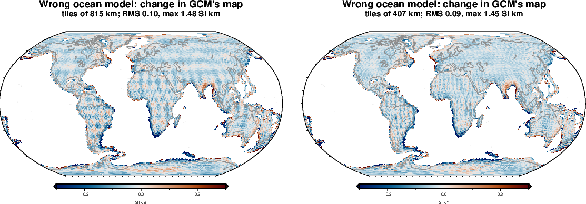

<!-- Rebuild from the repository root:
  export PYTHONPATH=benchmarks/verification:benchmarks:notebooks:$PYTHONPATH VECLIB_MAXIMUM_THREADS=3
  nice -n 15 conda run -n curiesphere python benchmarks/verification/gcm_checks.py g1   # ~3 min (eigendecomposition cached)
  nice -n 15 conda run -n curiesphere python benchmarks/verification/gcm_checks.py g2   # ~10 min
  nice -n 15 conda run -n curiesphere python benchmarks/verification/gcm_checks.py g3   # ~5 min
  conda run -n curiesphere python docs/verification/make_gcm_figures.py
  conda run -n riftsclimate quarto render docs/verification/inversion-gcm.qmd
-->

# In brief {.unnumbered}

**GCM is coded correctly.** It agrees with an independent solver to rounding error, returns a uniform truth exactly,
and its s.d. is exactly right when the data are as GCM assumes them, with its settings known or fitted.

**Its limitations:**

1. **Small patterns are weakly recovered.** With the noise of LCS-1, GCM recovers 77% of the contrast of a
   checkerboard of 815 km tiles, 67% at 407 km and 33% at 204 km. CM recovers about twice as much at 220 km for
   Australia: GCM's cells are not correlated with their neighbours, so it cannot pool them.
2. **Very broad patterns are lost too.** Tiles of 1630 km come back with only 44% of their contrast, because much of
   such a pattern lies below degree 16, where there are no data.
3. **A wrong ocean model lowers the whole map** by about 0.04 SI·km (4%) and changes 2–4% of the cells, near some
   continental margins, by more than 0.2 SI·km.

# What is checked, and how {#sec-method}

## GCM in one paragraph

GCM maps VIS on all continental crust (22,591 cells of about 100 km) as **one level plus an independent departure
in each cell**, damped toward the level. The data are the Gauss coefficients of LCS-1 in degrees 16–133 (17,700
numbers), weighted by the noise of each degree. Two settings, the noise scale σ and the s.d. τ of the departures,
are fitted by the evidence; given them, the map and its s.d. follow exactly from the data. GCM-GLC also runs with
domain levels and an error of the ocean model (ADRs 0008, 0009); this part checks the one-level map they build on.

## The test problem

All tests use the real global problem: the same cells, coefficients and weights as GCM-GLC. The synthetic data are
the truth's coefficients from the inversion's own cell columns, plus white noise after the weighting (σ = 1), which
is how GCM models the noise of LCS-1. The real fit finds σ = 1.53.

# Correctness checks {#sec-correct}

GCM solves the problem once by an eigendecomposition. The independent solver uses a different route: a Cholesky
factor of the 17,700 × 17,700 data-space matrix (@fig-gcm-g1).

| Check | Result |
|---|---|
| Map, every cell, at fixed damping | Equal to 4×10⁻⁶ SI·km (GCM leaves out directions with eigenvalues below 10⁻¹³ of the largest) |
| The level v0 | Equal to 2×10⁻¹⁴ SI·km |
| s.d., every cell | Equal to 1×10⁻¹³ (relative) |
| Log evidence, and its change when the damping doubles | Equal to 1×10⁻¹¹ |
| The s.d. GCM reports leaves out the level's uncertainty | It adds at most 0.07% to any cell's s.d. |
| Uniform truth (0.75 SI·km), no noise | Returned to 4×10⁻¹⁵ SI·km |

{#fig-gcm-g1}

## Uncertainties

Thirty truths were drawn from GCM's own model (level 0.75 SI·km, τ 0.5 SI·km, as in the real fit) and inverted
(@fig-gcm-spread).

| Settings | Error / s.d., spread (should be 1) | Within 1 s.d. (68%) | Within 2 s.d. (95%) |
|---|---|---|---|
| At the truth | 0.998 | 68.3% | 95.5% |
| Fitted | 1.002 | 68.1% | 95.4% |

The settings come back closely: σ 0.994–1.005 and τ 0.491–0.502 SI·km (middle 68% of truths). With 17,700 data
and two settings, fitting them costs nothing.

{#fig-gcm-spread}

# Limitations {#sec-limits}

## How large and how small a pattern GCM can see {#sec-gcm-shrink}

Checkerboards of equal-area tiles (HEALPix, 1.5 and 0.5 SI·km) were inverted without noise, with noise, and with
noise and a wrong ocean model (@fig-gcm-shrink-maps, @fig-gcm-shrink-contrast). Equal-area tiles keep their size
on the sphere, where squares of latitude and longitude shrink toward the poles.

| Tile size | No noise | Noise | Noise and wrong ocean model |
|---|---|---|---|
| 1630 km | 0.97 | 0.44 | 0.36 |
| 815 km | 0.93 | 0.77 | 0.73 |
| 407 km | 0.82 | 0.67 | 0.64 |
| 204 km | 0.68 | 0.33 | 0.29 |

: The recovered contrast, as a fraction of the true contrast. {#tbl-gcm-shrink}

- **GCM sees patterns of about 400–800 km best.** With noise it recovers two-thirds to three-quarters of their
  contrast.
- **Small patterns are weakly recovered.** At 204 km GCM recovers a third of the contrast, against about two-thirds
  for CM over Australia at 220 km with similar noise. GCM's prior treats every cell as independent, so it cannot
  pool neighbouring cells as CM's smooth field does.
- **Very broad patterns are lost as well.** The 1630 km tiles come back with less contrast (0.44) than the 815 km
  tiles. Degree 16, the lowest in the data, has a half-wavelength of about 1200 km, so much of a pattern this broad is
  not in the data at all. Without noise the sharp tile edges still reveal it; with noise they do not.
- **The s.d. does not follow this.** For the checkerboards, 81–99% of cells are within 1 s.d. at 407–1630 km, but
  only 63% at 204 km: GCM's s.d. is too wide for broad patterns and slightly too narrow for the smallest.

{#fig-gcm-shrink-maps}

{#fig-gcm-shrink-contrast}

## A wrong ocean model

GCM subtracts the field of the oceans computed with one remanence model (GK07). Here the synthetic oceans were made
with another (HM05), as in the earlier synthetic run `gcm_glc_syn_u1.0_oceanerr`. The difference in the weighted data
is 0.6 times the noise.

The wrong ocean model **lowers the whole map** by 0.033–0.038 SI·km, about 4% (the earlier uniform truth of 1.0 came
back as 0.963). It also **changes 2–4% of the cells by more than 0.2 SI·km** about that shift, mostly near
continental margins, such as around the Bay of Bengal (@fig-gcm-ocean). The recovered contrast drops by
0.03–0.09.

{#fig-gcm-ocean}

# What this means for real GCM maps {#sec-meaning}

- **The s.d. is right if the model is right**, but GCM's model of independent cells fits geology poorly: the s.d.
  is then too wide for broad features and too narrow for the smallest.
- **Read features of about 400–800 km**; expect a third to a half of the contrast to be lost at 200 km and at
  1600 km and beyond.
- **The overall level and the margins depend on the ocean model.** A different ocean remanence model shifts the
  map by about 4% and moves some margin cells by 0.2 SI·km or more.

# Still to do {#sec-todo}

- **GCM with domain levels and the ocean-model error** (ADRs 0008, 0009), as GCM-GLC runs.
- **DF-GLC**, the global DF.

# Rerunning {#sec-rerun}

The code is `benchmarks/verification/gcm_checks.py` (tests `g1`, `g2`, `g3`), with the maps drawn by
`docs/verification/make_gcm_figures.py`; the commands are at the top of this document's source. The tests use the
configuration `inversions/gcm_glc_lcs1_16-133.toml` and its cached eigendecomposition, run in one process (10–20 GB
of memory), and write their results to `benchmarks/verification/results/gcm_*`.
