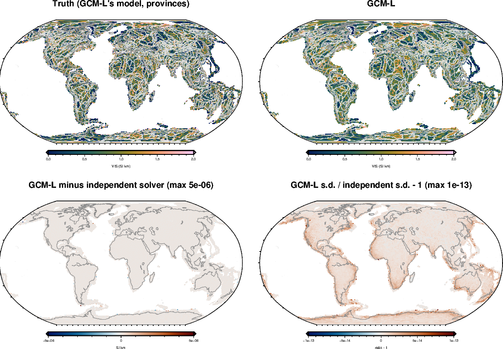

<!-- Rebuild from the repository root:
  export PYTHONPATH=benchmarks/verification:benchmarks:notebooks:$PYTHONPATH VECLIB_MAXIMUM_THREADS=3
  nice -n 15 conda run -n curiesphere python benchmarks/verification/gcml_checks.py l1      # ~20 min
  nice -n 15 conda run -n curiesphere python benchmarks/verification/gcml_checks.py l1x     # ~5 min
  nice -n 15 conda run -n curiesphere python benchmarks/verification/gcml_checks.py l2 0 5  # ~6 h
  PATH=~/anaconda3/envs/curiesphere/bin:$PATH PYTHONPATH=docs/verification:$PYTHONPATH \
      conda run -n curiesphere python docs/verification/make_gcml_figures.py
  conda run -n riftsclimate quarto render docs/verification/inversion-gcml.qmd
-->

# In brief {.unnumbered}

**GCM-L (global cell map with domain levels)** gives each domain of a layout (a polygon set) its own level, scattered
about one global level, and lets every cell depart independently from its domain's level. The spread of the levels
and of the cells are fitted, and the layouts are ranked by the evidence. It is the method the candidate polygon sets
were ranked with.

{#fig-gcml-real}

| Question | GCM-L | DF-GLC |
|---|---|---|
| Coded correctly? | [Yes: agrees with an independent solver to 10⁻¹²]{.good} | [Yes (see its report)]{.good} |
| Real provinces beat random and rotated polygon sets of the same number? | [Yes, by 280–960, in every draw]{.good} | [Yes, by 310–1400, in every draw]{.good} |
| Provinces that mean nothing (null) beat those controls? | [No, in no draw]{.good} | [No, in no draw]{.good} |
| Can "provinces beat one level" be trusted? | [No: it holds on the null too]{.poor} | [Mostly: no false wins, but it misses real steps when the pattern runs across edges]{.fair} |
| Province means within 1 s.d. (should be 68%) | [50–68%]{.fair} | [52–71%]{.fair} |

: GCM-L and DF-GLC on the same truths. {#tbl-gcml-brief}

::: {.callout-tip title="What this means for ranking polygon sets"}
- **Ranking polygon sets against random and rotated controls of the same size is sound with either method.** That
  is how the candidate sets were scored, so those rankings stand.
- **With GCM-L, never read "beats one level" or "beats a coarser set" as evidence of geology.** Its independent
  cells cannot represent a smooth field, so any set of many domains scores better.
- **For province values with an honest s.d., DF-GLC is the better choice** when its domains are right. Neither
  method's s.d. is trustworthy when the truth varies smoothly across the polygon edges.
:::

# How it was tested {#sec-method}

The real global problem, as the candidate-set runs: 22,591 cells, 17,700 coefficients (LCS-1, degrees 16–133), the
ocean-model error at 16 nT, and the noise held at its measured level. DF-GLC used one pattern shape (β 2, ℓ 700 km),
the shape of the truths and of its real fits.

| Truth | What it is | Right answer |
|---|---|---|
| **A** | a level per province, independent cells (GCM-L's own model) | provinces |
| **B** | a level per province, a pattern restarting at province edges (DF-GLC's own model) | provinces |
| **C** | one pattern across the continents, with steps in level at province edges | provinces |
| **D** | one pattern, no geology at all (null) | not provinces |

: Four truths, five draws each with fresh noise. {#tbl-gcml-truths}

Each was fitted with nine layouts: one level, the 437 Hasterok groups, the 724 provinces, three random tilings and
three rotated province sets with as many domains (the controls of the candidate-set tests).

# Correctness checks {#sec-correct}

| Check | Agreement |
|---|---|
| Log evidence, and its change between two settings | [identical to 10⁻⁴]{.good} |
| Map, every cell | [4.5×10⁻⁶ SI·km]{.good} |
| s.d., every cell | [1.5×10⁻¹³ (relative)]{.good} |
| Domain levels, and their s.d. | [1.5×10⁻¹², 4×10⁻¹⁴]{.good} |
| Province means, and their s.d. | [8×10⁻⁸ SI·km, 2×10⁻¹³]{.good} |
| One level per province, no noise, noise level fitted | [returned to 3×10⁻¹¹ SI·km]{.good} |
| The same with the noise held at its measured level | [errors up to 0.29 SI·km in the smallest provinces]{.fair} |

: GCM-L (eigendecomposition) against an independent solver (Cholesky factor of the full data-space covariance) on
the provinces layout. {#tbl-gcml-correct}

- **The fitted spreads come back**: cells 0.48 (true 0.49), provinces 0.24 (true 0.25).
- **Holding the noise at its measured level pulls small provinces toward the global level**, even for perfect data:
  provinces of 1–2 cells are off by 0.1 SI·km on average, large ones by 0.01. DF-GLC does the same.

{#fig-gcml-l1}

# Does the evidence pick the right polygons? {#sec-evidence}

{#fig-gcml-evidence}

| Truth | Provinces minus the best control, GCM-L | Provinces minus the best control, DF-GLC | Best of all nine, GCM-L | Best of all nine, DF-GLC |
|---|---|---|---|---|
| A | [+630 to +826]{.good} | [+410 to +506]{.good} | [provinces]{.good} | [provinces]{.good} |
| B | [+773 to +961]{.good} | [+1233 to +1401]{.good} | [provinces]{.good} | [provinces]{.good} |
| C | [+282 to +396]{.good} | [+308 to +437]{.good} | [provinces]{.good} | [one pattern]{.fair} |
| D (null) | [−139 to −232]{.good} | [−73 to −163]{.good} | [a random tiling]{.fair} | [one pattern]{.good} |

: Controls: three random tilings and three rotated province sets. Green: the right answer. {#tbl-gcml-evidence}

- **Against controls of the same size, both methods are right in all 20 cases.**
- **GCM-L always prefers many domains to few**, even on the null, where provinces beat one level by about 200.
- **DF-GLC prefers one pattern when the truth has no breaks (C, D)**: its domains force a break at every edge, so it
  misses the steps in C.

# Can the province means be read with their s.d.? {#sec-coverage}

{#fig-gcml-gallery}

| Truth | GCM-L, provinces | DF-GLC, provinces | DF-GLC, one pattern |
|---|---|---|---|
| A | [68%]{.good} | [68%]{.good} | [71%]{.good} |
| B | [63%]{.fair} | [68%]{.good} | [67%]{.good} |
| C | [52%]{.poor} | [52%]{.poor} | [64%]{.fair} |
| D | [50%]{.poor} | [52%]{.poor} | [71%]{.good} |

: Province means within 1 s.d. of the truth's (should be 68%), averaged over five draws. {#tbl-gcml-coverage}

| Truth | GCM-L, provinces | DF-GLC, provinces | DF-GLC, one pattern |
|---|---|---|---|
| A | 0.14 | 0.15 | 0.17 |
| B | 0.15 | 0.14 | 0.18 |
| C | 0.18 | 0.18 | 0.17 |
| D | 0.17 | 0.17 | 0.14 |

: RMS error of the province means (SI·km). {#tbl-gcml-error}

- **The province means are about equally good with both methods** (errors 0.14–0.18 SI·km).
- **Their s.d. is right only when the method's model matches the truth.** When VIS varies smoothly across province
  edges (C, D), both methods' province s.d. is about 1.5 times too small with the provinces layout.
- **DF-GLC with its preferred layout keeps its s.d. honest**: it picks one pattern for C and D, and then covers
  64–71%.
- **GCM-L's cell s.d. is too wide** for any truth but its own (87–91% within 1 s.d.); DF-GLC's is about right
  (65–69%), except on GCM-L's model (46%).

# Still to do {#sec-todo}

- The soft-boundary model of ADR 0010 (one pattern across edges plus patterns per domain), which truth C needs.
- The candidate polygon sets themselves through DF-GLC, now that the method is checked.

# Rerunning {#sec-rerun}

Code: `benchmarks/verification/gcml_checks.py` (tests `l1`, `l1x`, `l2`); maps:
`docs/verification/make_gcml_figures.py` and `make_overview_figures.py`. Commands at the top of this document's
source. Configuration `inversions/df_glc_lcs1_16-133.toml` (the ocean-model error at 16 nT) with GCM-L's cached
eigendecomposition and DF-GLC's shape decompositions in `benchmarks/verification/cache/df_glc`; results in
`benchmarks/verification/results/gcml_*`.
