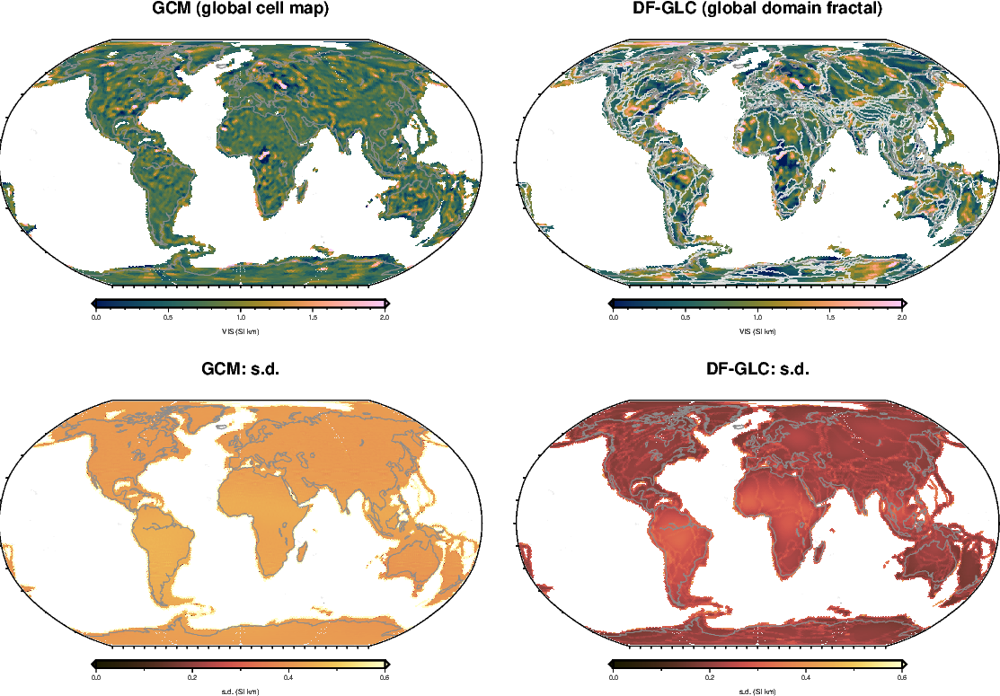
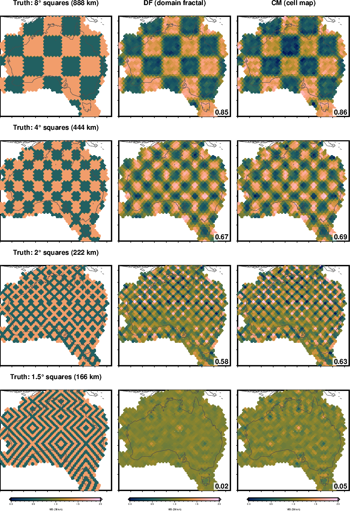
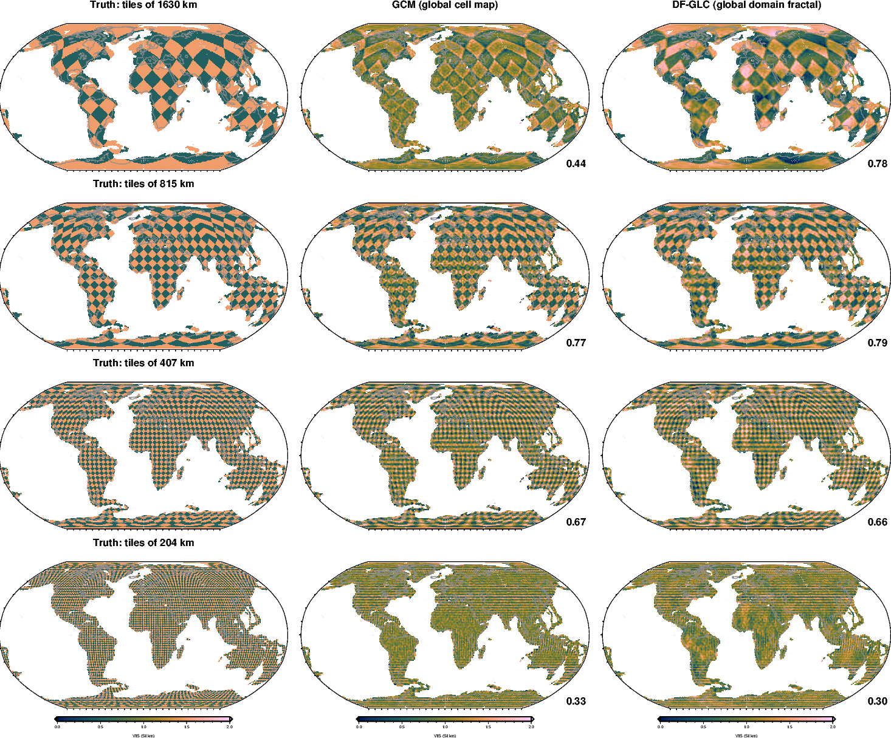

<!-- Figures: PATH=~/anaconda3/envs/curiesphere/bin:$PATH PYTHONPATH=docs/verification:$PYTHONPATH \
       conda run -n curiesphere python docs/verification/make_overview_figures.py
     Render: conda run -n riftsclimate quarto render docs/verification/inversion-overview.qmd -->

# The five methods

All five map VIS (vertically integrated susceptibility of the crust, SI·km) from the satellite field model LCS-1,
degrees 16–133.

| | Method | What it maps | Fit |
|---|---|---|---|
| **DF** | Domain fractal | A level per domain plus a fractal pattern inside each domain | Australia |
| **CM** | Cell map | A smooth field, one value per cell, about one level | Australia |
| **PD** | Polygon domains | One value per geological polygon | Australia |
| **GCM** | Global cell map | One value per cell, pulled toward one level | All continents |
| **DF-GLC** | Global domain fractal | DF's model, fitted to the whole globe | All continents |

{#fig-methods-aus}

{#fig-methods-global}

# Scorecard

| Method | Coded correctly? | Is its s.d. right on realistic data? | Broad patterns (1630 km) kept |
|---|---|---|---|
| **DF** | [Yes]{.good} | [1.1–1.2× too small]{.fair} | not tested |
| **CM** | [Yes]{.good} | [1.08× too small]{.fair} | [0.82]{.score} (over Australia) |
| **PD** | [Yes]{.good} | [about 3× too small]{.poor} | one value per domain |
| **GCM** | [Yes]{.good} | [Yes, except at sharp edges]{.good} | [0.44]{.score} |
| **DF-GLC** | [Yes]{.good} | [Yes, except at sharp edges]{.good} | [0.78]{.score} |

: "Coded correctly": agrees with an independent solver to rounding error. "Realistic data": noise as in the real
data, and for PD also VIS varying inside the domains. Broad patterns: fraction of the contrast recovered, with the
noise of the global fits.
{#tbl-scorecard}

# How small a pattern each method sees

The number in each corner is the fraction of the checkerboard's contrast that comes back, with noise (1 = all of it).

{#fig-gallery-aus}

{#fig-gallery-global}

- **About 200 km is the limit for every method.** At 170 km nothing comes back.
- Compare along a row, not between the two figures: the tiles differ and the global fits assume more noise.

# Why they differ

- **At 200–800 km the data set the limit, not the method.** On the same truths and noise, GCM matches CM at
  400–800 km and trails it by 0.08 at 204 km. Better resolution needs better data.
- **Broad patterns need a correlated field.** CM and DF-GLC carry them; GCM treats each cell as independent and
  loses them.
- **An s.d. is only as good as the method's assumptions.** GCM, DF-GLC and DF model the noise in full, but DF
  fits 43 settings to 849 data, which shrinks its s.d. CM approximates the noise; PD ignores both correlated noise
  and variation inside its polygons.
- **Local and global fits measure the noise differently** (against MF7 and MLI_SHA_2E). Until one is chosen,
  local and global maps are not directly comparable.

# What applies to all of them

::: {.callout-warning title="Reading any of these maps"}
- **A small s.d. can mean "nothing seen here"**, not "well known" (shown for DF and CM).
- **Sharp edges are blurred**, and the s.d. does not allow for it.
- **The resolution belongs to the data** (LCS-1, degrees 16–133), not to the method.
- **A wrong ocean model** shifts the global maps by about 4%.
:::
