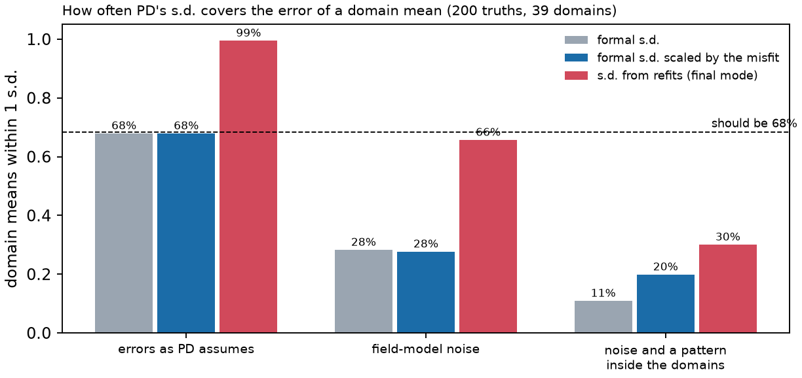

<!-- Rebuild from the repository root:
  export PYTHONPATH=benchmarks/verification:benchmarks:notebooks:$PYTHONPATH OMP_NUM_THREADS=1
  nice -n 15 conda run -n curiesphere python benchmarks/verification/pd_checks.py p1   # ~1 min
  nice -n 15 conda run -n curiesphere python benchmarks/verification/pd_checks.py p2   # ~5 min
  conda run -n curiesphere python docs/verification/make_pd_figures.py
  conda run -n riftsclimate quarto render docs/verification/inversion-pd.qmd
-->

# In brief {.unnumbered}

**PD (polygon domains)** gives each of the 39 geological polygons over Australia **one VIS**, the same in all its
cells, by least squares with VIS ≥ 0. It has no settings to fit. It reports a formal s.d. or, in final mode, the
spread of 100 refits with fresh noise.

{#fig-pd-real}

| Question | Answer |
|---|---|
| Coded correctly? | [Yes: exact for one level per polygon, and agrees with scipy's solver]{.good} |
| Formal s.d. right when errors are as PD assumes? | [Yes: 68% within 1 s.d.]{.good} |
| Formal s.d. right with real, correlated noise? | [No: 3× too small (28% within 1 s.d.)]{.poor} |
| Refit s.d. right with correlated noise? | [Yes: 66% within 1 s.d.]{.good} |
| Refit s.d. right when VIS varies inside the polygons? | [No: 3× too small (30% within 1 s.d.)]{.poor} |
| Are large polygons better known? | [No: the s.d. falls with area, the error does not]{.poor} |

: PD in one table. {#tbl-pd-brief}

::: {.callout-warning title="Reading a real PD map"}
- **Use the refit s.d., never the formal s.d.**
- **Treat even the refit s.d. as a lower bound.** The real data's misfit says VIS varies inside the polygons more
  than in these tests, so the true errors are likely more than 3× the s.d.
- **For domain means with an honest s.d., use DF (domain fractal)**, which models the variation inside each domain.
:::

# How it was tested {#sec-method}

Same problem as the [DF report](inversion-df.html): 1406 cells over Australia, data from degrees 16–133. 200
truths with one level per polygon (0.75 ± 0.3 SI·km), each with three kinds of data:

| Data | What it tests |
|---|---|
| **White errors**, as PD assumes | the formal s.d. under PD's own assumptions |
| **Correlated noise**, as on real data | what PD's diagonal weighting misses |
| **Correlated noise plus a pattern inside each polygon** (DF's fractal pattern) | what one value per polygon misses; the target is each polygon's mean |

: The three kinds of synthetic data. {#tbl-pd-data}

# Correctness checks {#sec-correct}

| Check | Agreement |
|---|---|
| One level per polygon, no noise | [returned to 1.5×10⁻¹⁴ SI·km]{.good} |
| Bounded least squares against scipy (8 levels at the bound) | [5×10⁻¹⁵ SI·km]{.good} |
| Formal s.d., white errors | [68% within 1 s.d.]{.good} |

: PD against exact cases and an independent solver. {#tbl-pd-correct}

{#fig-pd-p1}

# How far to trust PD's s.d. {#sec-limits}

| Data | Formal s.d. | Refit s.d. |
|---|---|---|
| White errors | [68%]{.good} | [99% (too wide)]{.fair} |
| Correlated noise | [28%]{.poor} | [66%]{.good} |
| Correlated noise and a pattern inside the polygons | [11%]{.poor} | [30%]{.poor} |

: Polygon means within 1 s.d. of the truth (should be 68%). {#tbl-pd-coverage}

{#fig-pd-coverage}

- **Correlated noise.** Neighbouring data points are not independent, as the formal s.d. assumes. The refits draw
  correlated noise and get it right.
- **Variation inside the polygons.** The refits draw noise only, so this error is not in any s.d. Differences
  between polygons are off nearly as much as the means.
- **For comparison, DF on the same kind of truth** has 56–62% of domain means within 1 s.d.

{#fig-pd-maps}

## Small and large polygons

{#fig-pd-area}

With a pattern inside, the error stays at 0.1–0.2 SI·km whatever the size while the s.d. falls, so **the largest
polygons are the most overconfident** (error 3–4× the s.d.).

# Rerunning {#sec-rerun}

Code: `benchmarks/verification/pd_checks.py` (tests `p1`, `p2`); maps: `docs/verification/make_pd_figures.py` and
`make_overview_figures.py`. Commands at the top of this document's source. Configuration
`inversions/pd_aus_lcs1_16-133.toml`; results in `benchmarks/verification/results/pd_*`.
