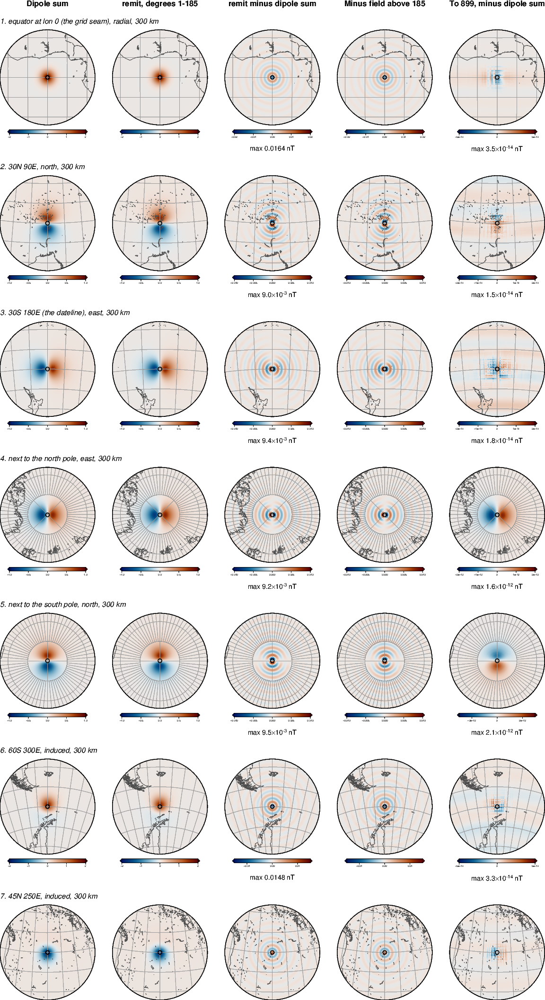
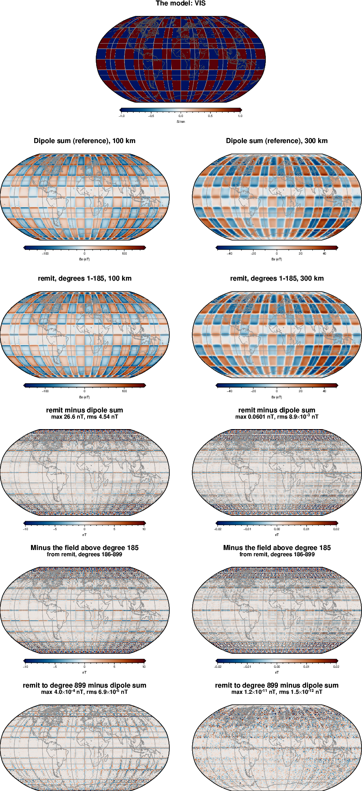
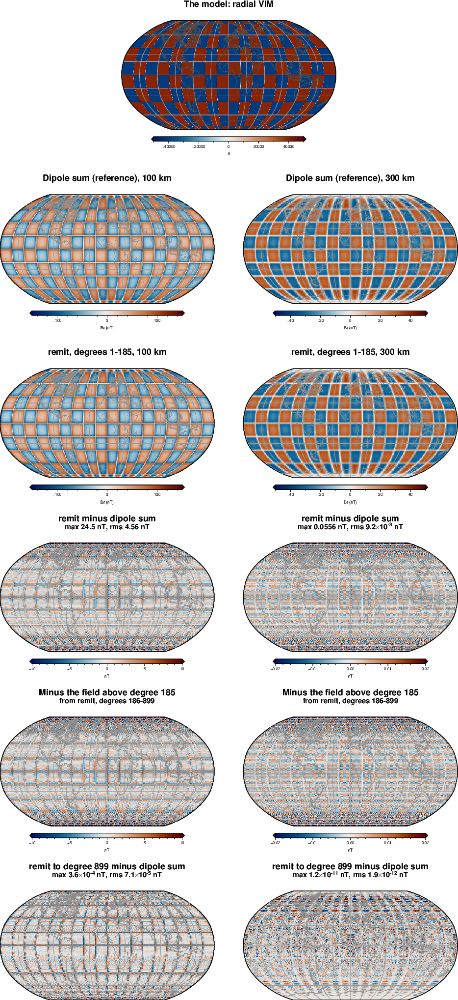
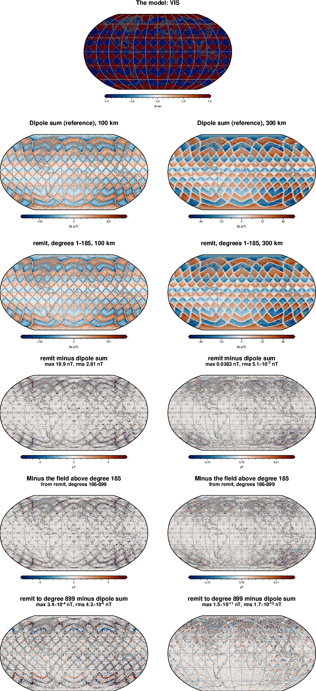
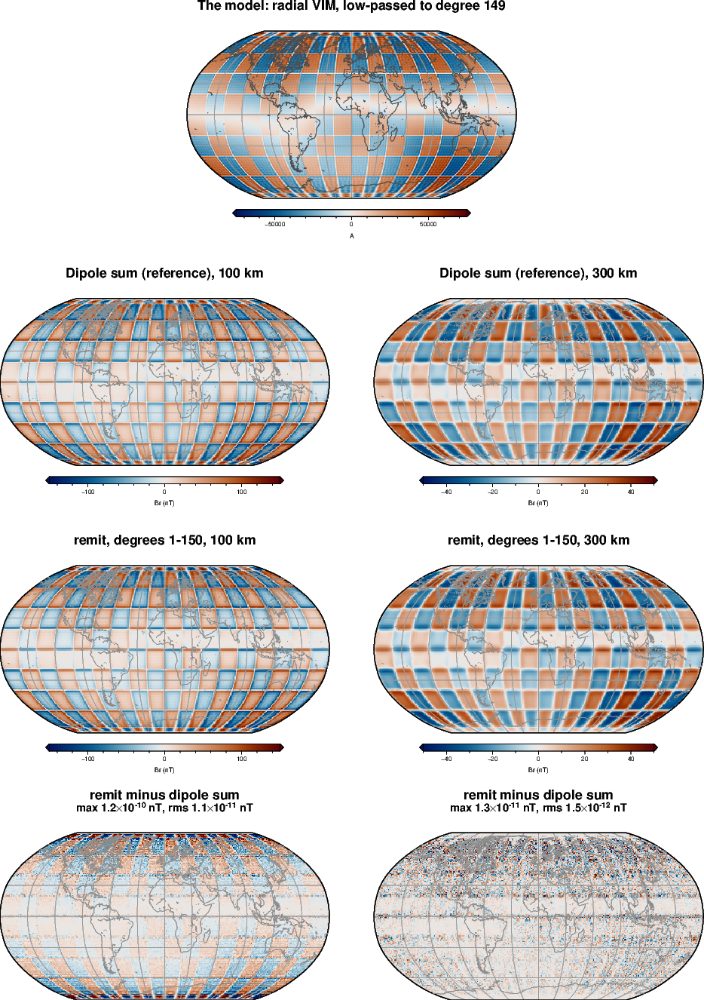
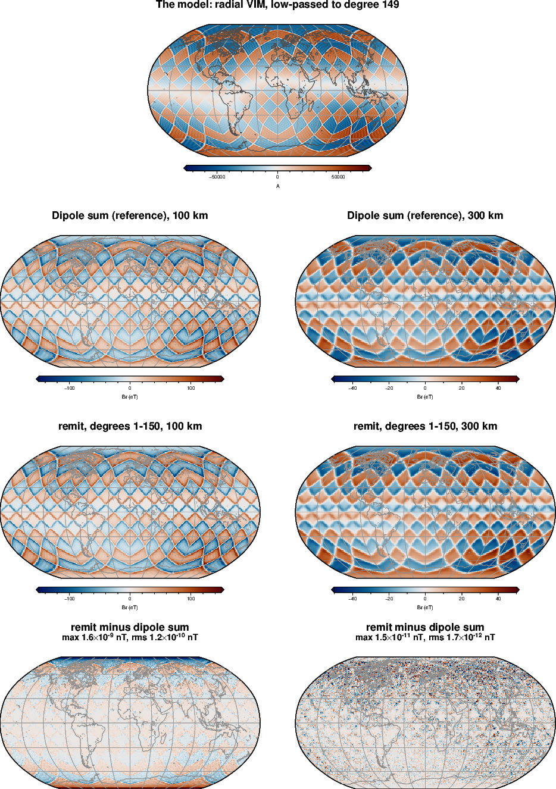
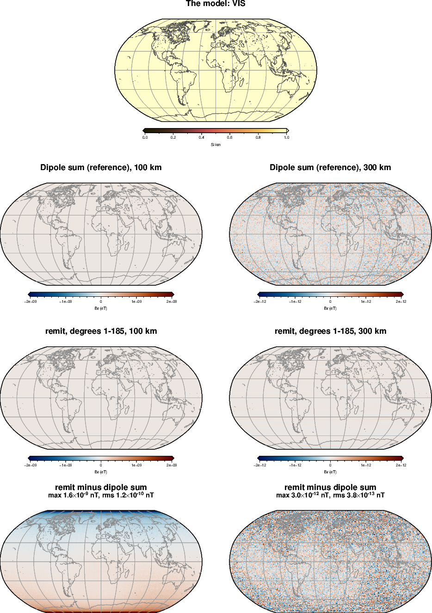
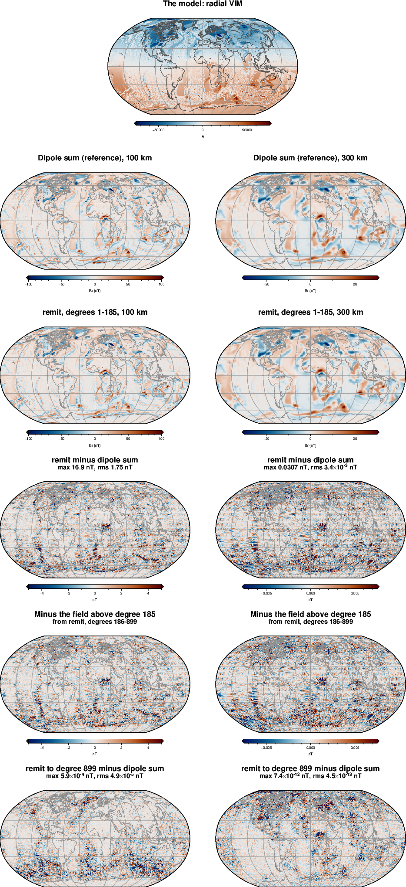
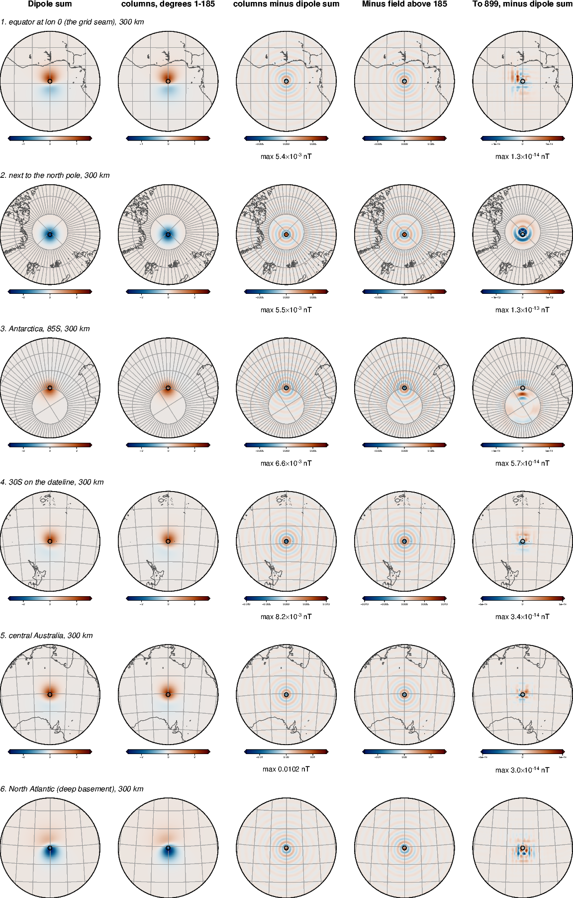
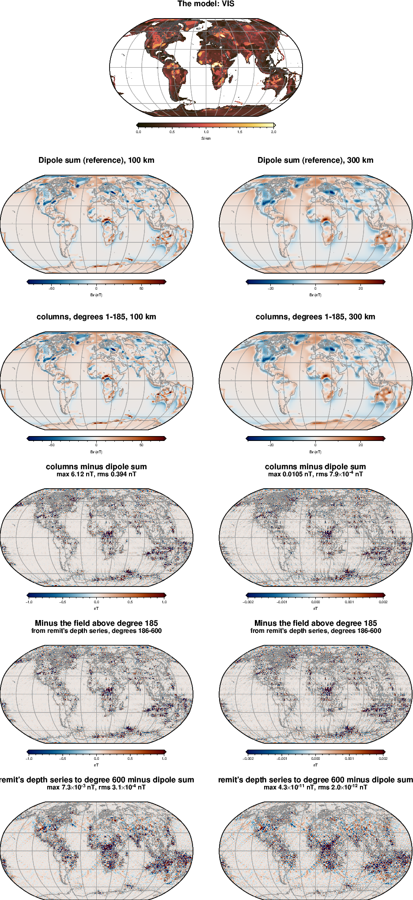

<!-- Rebuild from the repository root (see "Rerunning the checks" at the end):
  PYTHONPATH=benchmarks/verification:benchmarks:notebooks:$PYTHONPATH OMP_NUM_THREADS=3 \
      nice -n 15 conda run -n curiesphere python benchmarks/verification/forward.py
  PYTHONPATH=benchmarks/verification:benchmarks:notebooks:$PYTHONPATH OMP_NUM_THREADS=3 \
      nice -n 15 conda run -n curiesphere python benchmarks/verification/columns.py
  conda run -n curiesphere python docs/verification/make_figures.py
  conda run -n riftsclimate quarto render docs/verification/verification.qmd
-->

# In brief {.unnumbered}

- **Both forward models are right.** remit's global transform and the cell columns of the inversions give the
  same field as an independent sum of point dipoles, for every test model: single dipoles, checkerboards, a
  uniform shell, and the real ocean and continental models, with sources on the sphere or at their real depth.
- **"The same" means rounding error**, about 10⁻¹² of the field or less. Where the sources are sharp, remit to a
  given degree differs from the dipole sum by exactly the field above that degree, as it should, and that
  difference vanishes as the degree rises.
- **The awkward places of a spherical grid are fine**: the lon 0/360 seam, the dateline, and the rows next to
  both poles.
- **The columns the inversions read from disk** (all 22,591 continental cells) match remit to 5×10⁻¹⁴, and the
  float32 GPU columns change the field by at most 10⁻⁵ of its size.
- **One bug found and fixed**: the columns crashed for a cell containing the north pole. No result was affected.

# What is checked, and how {#sec-method}

curiesphere computes the magnetic field of magnetised crust in two ways:

- **remit's global transform** (`remit.vhtools`) turns a global grid of magnetisation into spherical-harmonic
  (Gauss) coefficients. With the depth series of `remit.depth`, it places the sources at their true depth. The
  ocean model, the background fields and the paper figures use it.
- **Cell columns** (`remit.inversion.columns`) give the Gauss coefficients of 1 SI·km of VIS in one cell, spread
  through the layer from the top of basement to 30 km. Every inversion is built from them.

Both are checked against a **direct sum of point dipoles**: each grid node is treated as a small magnet, and the
fields of all the magnets are added up at each observation point, in 3-D Cartesian coordinates. That calculation
shares no code with either model. It needs no spherical harmonics, no flat-Earth step and no assumption about
depth, so it is a fair referee.

## Why the two must agree, and what "agree" means

Both methods see exactly the same sources: one dipole per node of the 0.1° grid, of strength *magnetisation ×
node area*. The dipole sum adds up their full fields. remit computes the exact spherical-harmonic coefficients of
the same dipoles, but stops at a maximum degree (*lmax*; 185 in production). So:

> **remit to degree L, minus the dipole sum, equals minus the field of the same sources above degree L.**

remit can compute that missing part itself by going to a higher degree (up to 899 on the 0.1° grid). Every
test therefore makes two checks:

1. The difference between remit and the dipole sum looks **exactly like** minus the field above degree L, as
   remit computes it.
2. What is left once remit goes to degree 899 is either **rounding error** (about 10⁻¹² of the field or less),
   or, close to sharp sources at 100 km, the field above degree 899, which shrinks as expected.

For smooth (band-limited) models, there is no field above degree L, and remit must match the dipole sum to
rounding error at once.

All fields are the radial component Br, at 100 and 300 km above a sphere of radius 6371 km, with every degree
from 1 upwards. All maps are global (Robinson projection), except for point sources, which get zoomed maps
centred on each source.

::: {.callout-note}
## The sphere

Every calculation here is on the sphere. The dipole sum works with true 3-D positions and distances, so it is
exact for any geometry. The tests deliberately include places where a spherical grid is awkward: the lon 0/360
seam, the dateline, the rows next to both poles, and lon/lat squares that narrow toward the poles.
:::

# Test models {#sec-models}

| Model | What it is | What it tests |
|---|---|---|
| Planted dipoles | Seven single magnets: on the equator at lon 0 (the grid seam); at 30°N 90°E pointing north; at 30°S on the dateline pointing east; next to the north pole and next to the south pole (the grid rows nearest each pole), pointing along the surface; and two along the IGRF-13 field (60°S 300°E, 45°N 250°E) | Every magnetisation direction; grid edges and poles |
| Lon/lat checkerboard | 20° squares of VIS +1 and −1 SI·km, magnetised by IGRF-13; also as radial magnetisation ±40 A | Sharp edges everywhere; many small squares near the poles |
| HEALPix checkerboard | Equal-area tiles of about 15° (HEALPix NSIDE 4), VIS ±1 | The same with equal-area tiles, like the inversion cells |
| Uniform shell | VIS 1 SI·km everywhere, magnetised by IGRF-13 | A physical law: a uniformly susceptible shell magnetised by a field from inside it produces **no field outside** (Runcorn's theorem). Both methods must give zero. |
| Band-limited versions | Dipoles and checkerboards smoothed to degree 149 | Exact agreement at once, with no truncation |
| Real geology | The GK07 ocean remanence model plus the Hemant & Maus continental VIS (H&M), on the sphere and with realistic depth | The inputs used in the paper and the inversions |
| Single cells | Six inversion cells of 1 SI·km in the production layer | The cell columns, cell by cell |
| All continental cells | The inversions' own stored columns for all 22,591 cells, with a checkerboard and with H&M VIS | The forward model of the inversions as it is actually used |

# remit's global transform {#sec-remit}

## Reading the figures

Each figure has the model at the top, then five rows, with 100 km on the left and 300 km on the right:

1. **Dipole sum**: the reference field.
2. **remit to degree 185**: the production setting.
3. **remit minus dipole sum**: the difference, with its largest and RMS values.
4. **Minus the field above degree 185**, as remit computes it from degrees 186–899. Same colour scale as row 3:
   if remit is right, rows 3 and 4 look the same.
5. **remit to degree 899 minus dipole sum**: what is left once remit includes every degree the grid holds. This
   is the test of remit, and it should be rounding error at 300 km.

::: {.callout-important}
## Row 3 is not an error in remit

The differences in row 3 can be large: up to 22 nT next to a point dipole at 100 km, and 17 nT for the real
models. They are **not** a failure of remit. The dipole sum is the full field, with every degree; it cannot be
cut off at degree 185. remit at degree 185 leaves out, by design, the part of the field above degree 185, and row
3 shows how big that part is. Row 4 confirms that the difference is exactly that part, and nothing else. So rows 3
and 4 measure the cost of stopping at degree 185 (a property of the source model and the altitude), while row 5,
and the band-limited models, test the code.
:::

The colour scales of the difference rows saturate on purpose, so that thin features along sharp edges stay
visible; the largest value is given in each title. Band-limited models have no field above degree 150, so
there is nothing for remit to leave out: row 3 is already the test, and their figures stop there.

## Planted dipoles {#sec-dipoles}

A point dipole is the hardest test: its field contains every degree. @fig-dipoles-100 and @fig-dipoles-300 zoom
in on each of the seven dipoles.

- remit draws the same field as the dipole sum around every dipole. The difference at degree 185 (up to 22 nT
  next to a 50 nT peak at 100 km) is **exactly** the field above degree 185, ring for ring.
- With remit taken to degree 899, at 300 km what is left is 10⁻¹⁴ nT for five of the dipoles: rounding error.
- Next to the two poles, what is left is 2×10⁻¹² nT, a faint copy of the dipole's own field. That is still
  rounding (2×10⁻¹² of the field), but it is larger and coherent, because the grid weights of the rows next to the
  poles are tiny numbers and carry more relative rounding.
- At 100 km, degrees above 899 still matter right above a point source: 5×10⁻³ nT at most, against a peak of
  50 nT.

{#fig-dipoles-100}

{#fig-dipoles-300}

The same dipoles smoothed to degree 149 (@fig-dipoles-bl) have no field above degree 150. remit matches the
dipole sum to 4×10⁻¹² of the field at 100 km and 9×10⁻¹⁴ at 300 km, at every lmax from 150 up.

{#fig-dipoles-bl}

## Checkerboards {#sec-checker}

The lon/lat checkerboard (@fig-checker) has sharp edges everywhere, and its squares become thin wedges near
the poles. The difference between remit and the dipole sum lies along the edges, strongest where the wedges are
narrowest, and it is the same as the field above degree 185. With remit to degree 899, what is left is
1×10⁻¹¹ nT at 300 km (8×10⁻¹⁴ of the field). At 100 km it is 4×10⁻⁴ nT: the field above degree 899 along the
edges.

{#fig-checker}

Magnetised radially instead of along IGRF-13 (@fig-checker-radial), and on equal-area HEALPix tiles
(@fig-healpix), the results are the same. The smoothed versions (@fig-checker-bl, @fig-healpix-bl) agree to
2×10⁻¹³ and 3×10⁻¹² of the field at 100 km, and 8×10⁻¹⁴ at 300 km.

{#fig-checker-radial}

{#fig-healpix}

{#fig-checker-bl}

{#fig-healpix-bl}

## A uniform shell: no field outside {#sec-uniform}

A shell of uniform susceptibility magnetised by a field from inside it, such as IGRF-13, produces no field
outside (Runcorn's theorem). With VIS 1 SI·km everywhere (@fig-uniform), remit gives at most 3×10⁻¹² nT and
the dipole sum 2×10⁻⁹ nT, against about 50 nT for the checkerboard of the same strength. The dipole sum's
remainder is a smooth north–south pattern: the rounding left when 6.5 million dipole fields, each far larger,
cancel almost exactly. Both methods obey the theorem to rounding.

{#fig-uniform}

## Real geology {#sec-geology}

@fig-geology uses the models of the paper: GK07 ocean remanence and the Hemant & Maus continental VIS (H&M),
all sources on the 6371 km sphere. remit's induced magnetisation is its own; the dipole sum builds it
independently from VIS × IGRF-13. The difference at degree 185 again equals the field above 185, and with remit
to degree 899 what is left is 7×10⁻¹² nT at 300 km (10⁻¹³ of the field).

{#fig-geology}

@fig-geology-depth puts the same sources at their real depth: below water and sediment in the oceans, through
the GK07_NR remanent layer and the two H&M oceanic layers, in 1 km slices (the same slices for both methods).
remit handles depth with a series expansion (`remit.depth`, taken to degree 400 here). The difference at degree
185 equals the field above 185, and what is left at degree 400 is the field above 400 (10⁻⁶ nT at 300 km), as
for the sources on the sphere. This case uses a 2° map grid, because every slice is a full set of 6.5 million
dipoles.

{#fig-geology-depth}

## How much the cut at degree 185 matters

The checks above also measure the truncation error of the production setting (lmax 185) on real inputs. For
the real-geology models, the field above degree 185 is 0.07% (RMS) of the field at 300 km and 12% at 100 km. The
inversions fit degrees 16–133 only, so this does not affect them, but forward maps at low altitude need a
higher lmax.

## Summary table



: remit against the dipole sum, all cases. "Field above lmax" is the RMS of the field in degrees lmax+1 to 899
(400 for the depth case), from remit; for every case it equals the RMS of the difference. {#tbl-forward}

# The cell columns of the inversions {#sec-columns}

Every inversion builds its forward model from cell columns: for each HEALPix cell of about 100 km, the Gauss
coefficients of 1 SI·km of VIS spread evenly from the top of basement to 30 km below the ellipsoid, magnetised
along IGRF-13. The columns are summed node by node, with eight radii through the layer. They are checked in
three ways:

- **coefficient by coefficient**, against remit's global transform of the same cell;
- **field by field**, against the dipole sum; for single cells, the dipole sum uses 32 radii through the layer
  rather than 8, so the depth integration is checked as well;
- for all continental cells, using **the stored columns the inversions actually read**, in float64 and in the
  float32 version computed on the GPU.

## Six single cells

The cells sit on the lon 0 seam, at the north pole, at 85°S in Antarctica, on the dateline, in central Australia,
and on deep ocean basement in the North Atlantic (@fig-cells-100, @fig-cells-300). Each has VIS 1 SI·km.

- The columns match remit's transform of the same cell to 3×10⁻¹⁵ – 4×10⁻¹⁴ in every coefficient.
- Against the dipole sum, the difference at degree 185 is the field above 185 (what stopping at degree 185 leaves
  out, as in the remit figures, not an error), and with columns to degree 899
  what is left is 1×10⁻¹³ nT at 300 km (4×10⁻¹⁴ of the field). So eight radii are enough: the depth integral
  is exact to rounding, even at degree 899.
- The north-pole cell first failed (@sec-found); it now works.

{#fig-cells-100}

{#fig-cells-300}

## All continental cells, as the inversions use them

The inversions' stored columns for all 22,591 continental cells were combined with two VIS patterns: a HEALPix
checkerboard of 1.5 and 0.5 SI·km (@fig-cont-checker) and H&M VIS averaged over each cell (@fig-cont-geology).
The dipole sum puts every one of the 3.3 million continental grid nodes at the same eight radii. remit's depth
series of the same VIS, taken to degree 600, gives the field above degree 185.

- The float64 columns match remit's transform to 3–5×10⁻¹⁴ in every coefficient.
- The difference from the dipole sum at degree 185 is again the field above 185: the cost of the cut, not an
  error. With remit to degree 600, what is left is
  4×10⁻¹¹ nT at 300 km (4×10⁻¹³ of the field).
- The float32 columns from the GPU differ from the float64 ones by up to 3×10⁻⁶ in a coefficient, and change the
  field by at most 2×10⁻⁶ (300 km) and 1×10⁻⁵ (100 km) of its RMS. That is far inside the precision policy
  (ADR 0005).

{#fig-cont-checker}

{#fig-cont-geology}



: The cell columns against the dipole sum. For all continental cells, the highest-lmax rows (600) are remit's
depth series of the same VIS, which gives the field above 185. {#tbl-columns}


